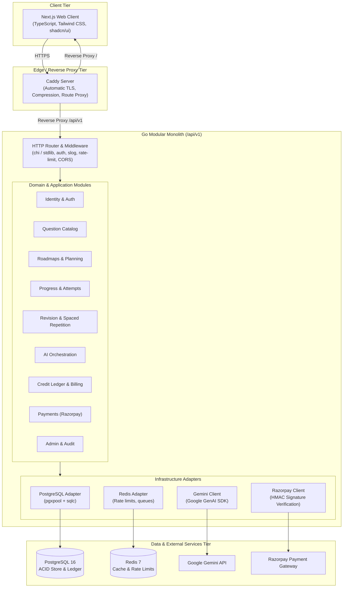
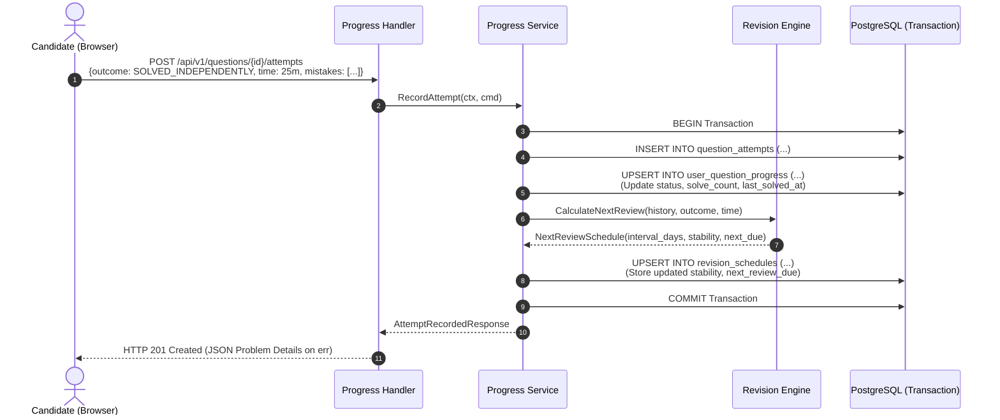
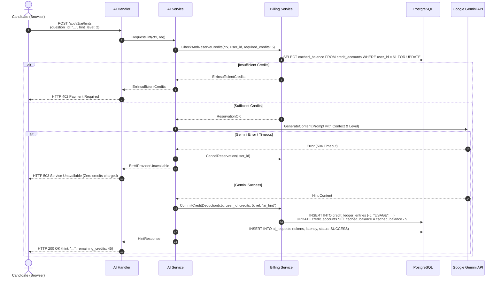
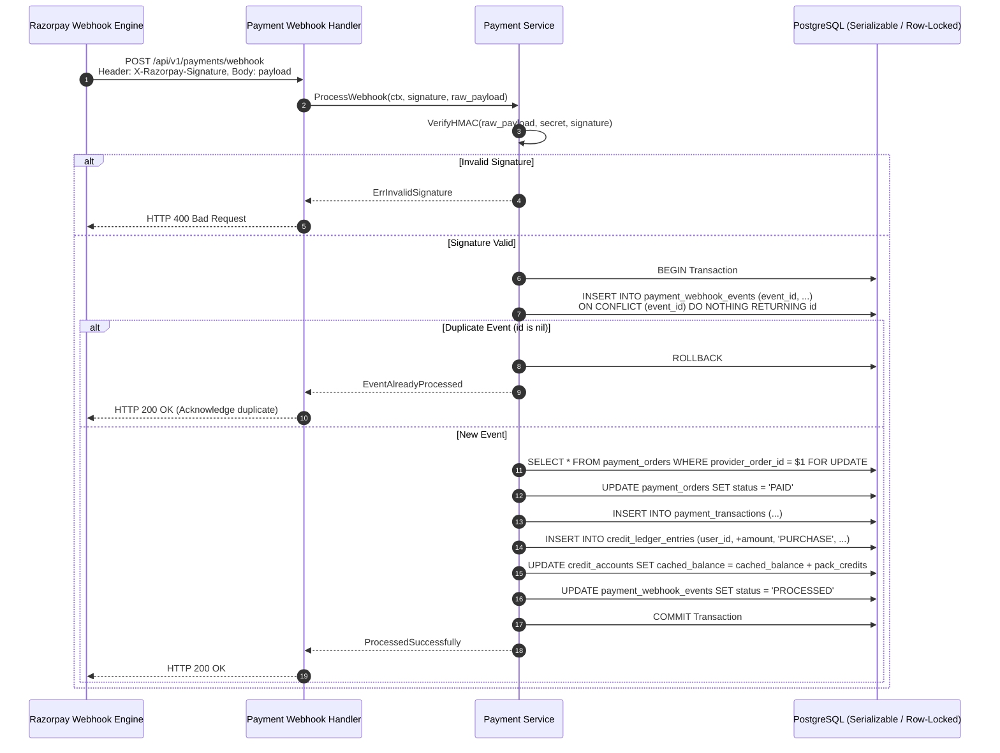

# System Architecture — Adaptive DSA Interview Preparation Platform

## 1. Architectural Style & Philosophy

The platform is designed as a **Go Modular Monolith** coupled with a modern **Next.js frontend**. It follows clean, inward-pointing architectural boundaries (Hexagonal / Ports and Adapters).

### Core Principles
1. **Inward-Pointing Dependencies**:
   - `HTTP Handlers / Transports` $\rightarrow$ `Application Services (Use Cases)` $\rightarrow$ `Domain Entities & Invariants`.
   - Domain logic and business rules never import database drivers, HTTP frameworks, or external SDKs.
   - Application services define repository and provider interfaces; infrastructure packages implement them.
2. **Single Deployable Unit**:
   - The entire backend compiles into a single, highly efficient Go binary with minimal memory footprint (< 50MB RSS under normal load), avoiding the operational overhead, network latency, and distributed transaction complexity of microservices.
3. **Explicit Dependency Injection**:
   - Components receive their dependencies explicitly via Go struct constructors (e.g., `NewService(repo, aiProvider, logger)`).
   - No magic dependency-injection reflection frameworks are used.
4. **Authoritative PostgreSQL Source of Truth**:
   - PostgreSQL 16 is the single source of truth for all transactional data, progress state, credit ledgers, and audit logs.
   - Redis is used strictly for transient concerns: distributed rate limiting, session caching/token blacklisting, and background job queues.

---

## 2. High-Level System Architecture



---

## 3. Go Project Structure (Standard Layout)

The project adheres to the idiomatic Go project layout:

```text
adaptive-dsa/
├── cmd/
│   ├── server/             # Main HTTP API application entrypoint
│   │   └── main.go
│   ├── migrate/            # CLI tool for executing Goose database migrations
│   │   └── main.go
│   └── import-questions/   # CLI tool for validated question spreadsheet import
│       └── main.go
├── internal/               # Private application code (cannot be imported externally)
│   ├── config/             # Environment variable parsing and validation
│   ├── platform/           # Shared technical infrastructure
│   │   ├── database/       # pgxpool setup, transaction helpers, health checks
│   │   ├── redis/          # Redis connection and rate-limit helpers
│   │   ├── logger/         # log/slog initialization with request correlation
│   │   ├── httperr/        # RFC 9457 Problem Details error response builders
│   │   └── middleware/     # Auth, session, request ID, CORS, recovery, rate-limit
│   ├── identity/           # User registration, Argon2id passwords, sessions, RBAC
│   │   ├── domain.go       # User, Session, Role entities
│   │   ├── service.go      # Register, Login, RevokeSession use cases
│   │   ├── repository.go   # Storage interface definition
│   │   └── handler.go      # HTTP handlers (/api/v1/auth/*)
│   ├── catalog/            # Curated questions, patterns, company evidence
│   ├── roadmap/            # Roadmaps, stage progression, personalization logic
│   ├── progress/           # User attempts, canonical question progress, notes
│   ├── revision/           # SM-2 / spaced repetition engine, overdue scheduling
│   ├── ai/                 # Gemini provider adapter, prompt templates, token counting
│   ├── billing/            # Credit accounts, double-entry immutable ledger
│   ├── payments/           # Razorpay order generation, webhook signature verification
│   ├── admin/              # User management, catalog edits, audit logs
│   └── database/           # sqlc generated code and SQL queries
│       ├── queries/        # Raw parameterized SQL queries
│       │   ├── users.sql
│       │   ├── catalog.sql
│       │   ├── progress.sql
│       │   ├── ledger.sql
│       │   └── payments.sql
│       └── generated/      # sqlc compiled Go models and query functions
├── migrations/             # Goose SQL migration files (00001_init.sql, etc.)
├── pkg/                    # Reusable public packages (if applicable)
├── docs/                   # Architecture, specifications, and ADRs
├── web/                    # Next.js frontend application
│   ├── src/
│   │   ├── app/            # Next.js App Router pages and layouts
│   │   ├── components/     # UI components (shadcn/ui, modals, charts)
│   │   ├── lib/            # Typed API client, auth session context
│   │   └── types/          # Shared TypeScript interfaces
├── Dockerfile              # Multi-stage production build for Go server
├── docker-compose.yml      # Local dev environment (Go, Postgres, Redis, Caddy)
└── Makefile                # Common engineering tasks (build, test, lint, migrate)
```

---

## 4. Module Boundaries & Interaction Contracts

Each module maintains strict encapsulation. Cross-module calls occur either through explicit application service interfaces or database transactions orchestrated by a coordinator service.

| Module | Core Responsibility | External Dependencies | Invariants Enforced |
| :--- | :--- | :--- | :--- |
| **`identity`** | User credentials, Argon2id hashing, server sessions, RBAC. | PostgreSQL, Redis (session cache). | Passwords hashed with Argon2id; session tokens cryptographically random 32-byte strings; email unique. |
| **`catalog`** | Canonical questions, patterns, subpatterns, company evidence. | PostgreSQL. | Canonical question identity is global; URLs/slugs are unique; company tags require source metadata. |
| **`roadmap`** | Master and personalized study roadmaps. | Catalog module. | Roadmaps reference canonical questions; removing a roadmap item never deletes user progress. |
| **`progress`** | User attempts, current question progress, notes, bookmarks. | Catalog module, PostgreSQL. | Exactly **one** `user_question_progress` row per `(user_id, question_id)`. Attempts are immutable logs. |
| **`revision`** | Spaced repetition engine, dynamic intervals, overdue triage. | Progress module, PostgreSQL. | Overdue items triaged by retention decay; intervals adapt to independent solving outcome. |
| **`ai`** | Pedagogical hints, approach reviews, prompt sanitization. | Gemini API, Billing module. | Request payload bounded; system prompt isolated; zero credit charge on provider timeout/error. |
| **`billing`** | Credit accounts, credit packs, double-entry immutable ledger. | PostgreSQL. | All balances represented as integers; every balance modification backed by an immutable ledger row. |
| **`payments`** | Razorpay order creation, webhook verification, idempotency. | Billing module, Razorpay API. | Webhook HMAC-SHA256 signature verified; idempotency key prevents duplicate credit grants; atomic execution. |
| **`admin`** | User moderation, catalog management, audit logging. | All modules, PostgreSQL. | All admin mutations record immutable audit log with actor ID, target ID, and payload delta. |

---

## 5. Critical Request Flows

### A. Logging a Practice Attempt & Updating Revision Schedule



### B. Progressive AI Hint Request with Credit Reservation



### C. Razorpay Webhook Processing with Idempotency & Atomic Credit Grant



---

## 6. Cross-Cutting Technical Concerns

### Structured Logging (`log/slog`)
- Log entries are output as JSON in production and structured text in local development.
- Middleware injects a unique `request_id` (UUIDv7 or ULID) into the Go `context.Context` and every log line.
- Sensitive fields (passwords, session cookies, payment signatures, card data, AI API keys) are **strictly masked or omitted**.

### Error Handling: RFC 9457 Problem Details
All API errors return a standard JSON payload:
```json
{
  "type": "https://api.adaptivedsa.dev/errors/insufficient-credits",
  "title": "Insufficient Credits",
  "status": 402,
  "detail": "Your balance of 2 credits is insufficient for this operation (requires 5 credits).",
  "instance": "/api/v1/ai/hints",
  "code": "INSUFFICIENT_CREDITS"
}
```

### Context Propagation & Graceful Shutdown
- Every HTTP request passes `r.Context()` directly to database queries and external HTTP calls.
- Database queries enforce bounded timeouts (e.g., 3s default, 15s for heavy report queries).
- On `SIGINT`/`SIGTERM`, the Go server stops accepting new connections, allows in-flight requests 10 seconds to finish, closes the `pgxpool` connection pool cleanly, and flushes log buffers.

### Database Connection Pooling (`pgxpool`)
Configured to prevent connection exhaustion while ensuring high concurrency:
- `MaxConns`: 25 (calibrated for modest VPS with 2–4 CPU cores).
- `MinConns`: 5 (keeps warm connections ready).
- `MaxConnLifetime`: 30 minutes.
- `MaxConnIdleTime`: 5 minutes.
- `HealthCheckPeriod`: 1 minute.

---

## 7. Frontend Architecture (Next.js & TypeScript)

- **Framework**: Next.js 14+ (App Router).
- **Styling**: Tailwind CSS with shadcn/ui components (Radix UI primitives).
- **Architecture**:
  - *Server Components (RSC)*: Used for static landing pages, catalog search views, and read-only roadmap displays.
  - *Client Components (`"use client"`)*: Used for interactive attempt-logging modals, real-time stopwatch timers, hint reveal accordions, and checkout triggers.
  - *Typed API Client*: Generated or hand-crafted TypeScript SDK that guarantees 1:1 typing with Go API models and handles cookie-based authentication automatically.
