# Database Design & Schema Specification — Adaptive DSA Interview Preparation Platform

## 1. Storage Philosophy & Technology Choice

The platform relies on **PostgreSQL 16** as its authoritative, ACID-compliant data store.
- **Data Integrity**: Enforced directly at the database layer using foreign keys, check constraints, unique indexes, and non-nullable columns, preventing application bugs from corrupting data.
- **Primary Key Strategy**: **UUIDv7** (RFC 9562) is adopted across all transactional tables.
  - *Why UUIDv7 over random UUIDv4?* UUIDv7 embeds a millisecond-precision Unix timestamp in its most significant 48 bits. This preserves sequential B-Tree index locality, eliminating the severe cache-miss and random I/O write-amplification penalties of UUIDv4 while maintaining global uniqueness and avoiding exposed sequential integers (`BIGSERIAL`).
  - *UUID Generation Architecture*: PostgreSQL 16 does not natively provide a UUIDv7 function. UUIDv7 generation is performed client-side by Go application services before insertion via `github.com/google/uuid` (v1.6+), while database-level column defaults use PostgreSQL 16's built-in `gen_random_uuid()` without requiring external extensions.
- **Migration & Code Generation**:
  - **Goose**: Schema migrations are versioned SQL scripts. No dynamic ORM auto-migration in production.
  - **sqlc**: SQL queries are written in raw, idiomatic PostgreSQL syntax and compiled to type-safe Go structs and methods.

---

## 2. Entity-Relationship Overview

```mermaid
erDiagram
    USERS ||--o{ SESSIONS : "has"
    USERS ||--o{ USER_QUESTION_PROGRESS : "tracks"
    USERS ||--o{ QUESTION_ATTEMPTS : "records"
    USERS ||--o{ REVISION_SCHEDULES : "maintains"
    USERS ||--o{ CREDIT_ACCOUNTS : "owns"
    USERS ||--o{ CREDIT_LEDGER_ENTRIES : "owns"
    USERS ||--o{ PAYMENT_ORDERS : "places"
    USERS ||--o{ ROADMAPS : "creates"

    PATTERNS ||--o{ PATTERNS : "subpattern of"
    PATTERNS ||--o{ QUESTION_PATTERNS : "tags"
    QUESTIONS ||--o{ QUESTION_PATTERNS : "categorized under"
    QUESTIONS ||--o{ QUESTION_PREREQUISITES : "requires"
    COMPANIES ||--o{ QUESTION_COMPANY_EVIDENCE : "linked to"
    QUESTIONS ||--o{ QUESTION_COMPANY_EVIDENCE : "featured in"

    QUESTIONS ||--o{ ROADMAP_ITEMS : "included in"
    ROADMAPS ||--o{ ROADMAP_ITEMS : "contains"

    QUESTIONS ||--o{ USER_QUESTION_PROGRESS : "canonical progress"
    QUESTIONS ||--o{ QUESTION_ATTEMPTS : "target of"
    QUESTIONS ||--o{ REVISION_SCHEDULES : "scheduled for"

    CREDIT_PACKS ||--o{ PAYMENT_ORDERS : "purchased via"
    PAYMENT_ORDERS ||--o{ PAYMENT_TRANSACTIONS : "settled by"
```



---

## 3. Physical Schema Definition

### 3.1. Identity & Access Control

```sql
-- Enums
CREATE TYPE user_role AS ENUM ('CANDIDATE', 'ADMIN');
CREATE TYPE auth_provider AS ENUM ('LOCAL', 'GITHUB', 'GOOGLE');

-- Users table
CREATE TABLE users (
    id UUID PRIMARY KEY DEFAULT gen_random_uuid(),
    email VARCHAR(255) NOT NULL UNIQUE,
    password_hash VARCHAR(255) NOT NULL, -- Argon2id encoded string
    full_name VARCHAR(120) NOT NULL,
    role user_role NOT NULL DEFAULT 'CANDIDATE',
    auth_provider auth_provider NOT NULL DEFAULT 'LOCAL',
    is_active BOOLEAN NOT NULL DEFAULT TRUE,
    created_at TIMESTAMPTZ NOT NULL DEFAULT CURRENT_TIMESTAMP,
    updated_at TIMESTAMPTZ NOT NULL DEFAULT CURRENT_TIMESTAMP
);

-- Server-side sessions (Stateful auth stored in PostgreSQL)
CREATE TABLE sessions (
    id UUID PRIMARY KEY DEFAULT gen_random_uuid(),
    user_id UUID NOT NULL REFERENCES users(id) ON DELETE CASCADE,
    session_token_hash VARCHAR(64) NOT NULL UNIQUE, -- SHA-256 hash of raw session cookie
    ip_address INET,
    user_agent TEXT,
    expires_at TIMESTAMPTZ NOT NULL,
    created_at TIMESTAMPTZ NOT NULL DEFAULT CURRENT_TIMESTAMP,
    last_active_at TIMESTAMPTZ NOT NULL DEFAULT CURRENT_TIMESTAMP
);

CREATE INDEX idx_sessions_user_id ON sessions(user_id);
CREATE INDEX idx_sessions_expires_at ON sessions(expires_at);

-- Password reset tokens
CREATE TABLE password_reset_tokens (
    id UUID PRIMARY KEY DEFAULT gen_random_uuid(),
    user_id UUID NOT NULL REFERENCES users(id) ON DELETE CASCADE,
    token_hash VARCHAR(64) NOT NULL UNIQUE,
    expires_at TIMESTAMPTZ NOT NULL,
    is_used BOOLEAN NOT NULL DEFAULT FALSE,
    created_at TIMESTAMPTZ NOT NULL DEFAULT CURRENT_TIMESTAMP
);
```

### 3.2. Curated Question Catalog & Pattern Tree

```sql
CREATE TYPE question_difficulty AS ENUM ('EASY', 'MEDIUM', 'HARD');
CREATE TYPE evidence_confidence AS ENUM ('LOW', 'MEDIUM', 'HIGH', 'CONFIRMED');

-- Hierarchical Pattern tree (e.g., Arrays -> Two Pointers -> Opposite Direction)
CREATE TABLE patterns (
    id UUID PRIMARY KEY DEFAULT gen_random_uuid(),
    parent_id UUID REFERENCES patterns(id) ON DELETE CASCADE,
    name VARCHAR(100) NOT NULL,
    slug VARCHAR(100) NOT NULL UNIQUE,
    description TEXT,
    display_order INT NOT NULL DEFAULT 0,
    created_at TIMESTAMPTZ NOT NULL DEFAULT CURRENT_TIMESTAMP
);

CREATE INDEX idx_patterns_parent_id ON patterns(parent_id);

-- Canonical Questions Bank (Single source of truth)
CREATE TABLE questions (
    id UUID PRIMARY KEY DEFAULT gen_random_uuid(),
    slug VARCHAR(150) NOT NULL UNIQUE,
    title VARCHAR(255) NOT NULL,
    external_url TEXT NOT NULL,
    difficulty question_difficulty NOT NULL,
    is_core BOOLEAN NOT NULL DEFAULT FALSE, -- Core vs Reinforcement variation
    editorial_summary TEXT,
    sample_time_limit_mins INT NOT NULL DEFAULT 30,
    created_at TIMESTAMPTZ NOT NULL DEFAULT CURRENT_TIMESTAMP,
    updated_at TIMESTAMPTZ NOT NULL DEFAULT CURRENT_TIMESTAMP
);

-- Many-to-many relationship: Question to Patterns
CREATE TABLE question_patterns (
    question_id UUID NOT NULL REFERENCES questions(id) ON DELETE CASCADE,
    pattern_id UUID NOT NULL REFERENCES patterns(id) ON DELETE CASCADE,
    is_primary BOOLEAN NOT NULL DEFAULT FALSE,
    PRIMARY KEY (question_id, pattern_id)
);

-- Question Prerequisites (e.g., Reverse Linked List is prerequisite for Reorder List)
CREATE TABLE question_prerequisites (
    question_id UUID NOT NULL REFERENCES questions(id) ON DELETE CASCADE,
    prerequisite_question_id UUID NOT NULL REFERENCES questions(id) ON DELETE CASCADE,
    reason VARCHAR(255),
    PRIMARY KEY (question_id, prerequisite_question_id),
    CONSTRAINT chk_no_self_prereq CHECK (question_id <> prerequisite_question_id)
);

-- Companies
CREATE TABLE companies (
    id UUID PRIMARY KEY DEFAULT gen_random_uuid(),
    name VARCHAR(100) NOT NULL UNIQUE,
    slug VARCHAR(100) NOT NULL UNIQUE,
    created_at TIMESTAMPTZ NOT NULL DEFAULT CURRENT_TIMESTAMP
);

-- Honest Company Evidence (with dates and provenance)
CREATE TABLE question_company_evidence (
    id UUID PRIMARY KEY DEFAULT gen_random_uuid(),
    question_id UUID NOT NULL REFERENCES questions(id) ON DELETE CASCADE,
    company_id UUID NOT NULL REFERENCES companies(id) ON DELETE CASCADE,
    source_description VARCHAR(255) NOT NULL,
    evidence_date DATE NOT NULL,
    confidence evidence_confidence NOT NULL DEFAULT 'MEDIUM',
    created_at TIMESTAMPTZ NOT NULL DEFAULT CURRENT_TIMESTAMP,
    UNIQUE (question_id, company_id, source_description, evidence_date)
);

CREATE INDEX idx_company_evidence_lookup ON question_company_evidence(company_id, question_id);
```

### 3.3. Roadmaps & Planning

```sql
CREATE TABLE roadmaps (
    id UUID PRIMARY KEY DEFAULT gen_random_uuid(),
    user_id UUID REFERENCES users(id) ON DELETE CASCADE, -- NULL indicates canonical public master roadmap
    title VARCHAR(150) NOT NULL,
    description TEXT,
    target_company_id UUID REFERENCES companies(id) ON DELETE SET NULL,
    target_days INT NOT NULL DEFAULT 60,
    is_system_template BOOLEAN NOT NULL DEFAULT FALSE,
    created_at TIMESTAMPTZ NOT NULL DEFAULT CURRENT_TIMESTAMP
);

CREATE TABLE roadmap_items (
    id UUID PRIMARY KEY DEFAULT gen_random_uuid(),
    roadmap_id UUID NOT NULL REFERENCES roadmaps(id) ON DELETE CASCADE,
    question_id UUID NOT NULL REFERENCES questions(id) ON DELETE CASCADE,
    stage_number INT NOT NULL DEFAULT 1,
    position INT NOT NULL,
    is_mandatory BOOLEAN NOT NULL DEFAULT TRUE,
    created_at TIMESTAMPTZ NOT NULL DEFAULT CURRENT_TIMESTAMP,
    UNIQUE (roadmap_id, question_id),
    UNIQUE (roadmap_id, stage_number, position)
);
```

### 3.4. User Preparation, Progress & Revision Engine

```sql
CREATE TYPE progress_status AS ENUM ('NOT_STARTED', 'IN_PROGRESS', 'SOLVED', 'MASTERED');
CREATE TYPE attempt_outcome AS ENUM (
    'SOLVED_INDEPENDENTLY',
    'SOLVED_WITH_HINTS',
    'SOLVED_AFTER_EDITORIAL',
    'UNRESOLVED_FAILED'
);
CREATE TYPE perceived_difficulty AS ENUM ('EASY', 'JUST_RIGHT', 'CHALLENGING', 'OVERWHELMING');

-- Exactly ONE canonical progress row per user per question across all roadmaps
CREATE TABLE user_question_progress (
    id UUID PRIMARY KEY DEFAULT gen_random_uuid(),
    user_id UUID NOT NULL REFERENCES users(id) ON DELETE CASCADE,
    question_id UUID NOT NULL REFERENCES questions(id) ON DELETE CASCADE,
    status progress_status NOT NULL DEFAULT 'NOT_STARTED',
    first_solved_at TIMESTAMPTZ,
    last_solved_at TIMESTAMPTZ,
    solve_count INT NOT NULL DEFAULT 0,
    independent_solve_count INT NOT NULL DEFAULT 0,
    total_time_spent_secs INT NOT NULL DEFAULT 0,
    is_bookmarked BOOLEAN NOT NULL DEFAULT FALSE,
    personal_notes TEXT,
    created_at TIMESTAMPTZ NOT NULL DEFAULT CURRENT_TIMESTAMP,
    updated_at TIMESTAMPTZ NOT NULL DEFAULT CURRENT_TIMESTAMP,
    UNIQUE (user_id, question_id)
);

CREATE INDEX idx_user_progress_status ON user_question_progress(user_id, status);

-- Immutable chronological attempt history
CREATE TABLE question_attempts (
    id UUID PRIMARY KEY DEFAULT gen_random_uuid(),
    user_id UUID NOT NULL REFERENCES users(id) ON DELETE CASCADE,
    question_id UUID NOT NULL REFERENCES questions(id) ON DELETE CASCADE,
    roadmap_id UUID REFERENCES roadmaps(id) ON DELETE SET NULL,
    attempt_date TIMESTAMPTZ NOT NULL DEFAULT CURRENT_TIMESTAMP,
    outcome attempt_outcome NOT NULL,
    time_spent_secs INT NOT NULL,
    difficulty_experienced perceived_difficulty NOT NULL,
    mistake_tags TEXT[] NOT NULL DEFAULT '{}',
    approach_summary TEXT,
    code_snippet TEXT,
    created_at TIMESTAMPTZ NOT NULL DEFAULT CURRENT_TIMESTAMP
);

CREATE INDEX idx_attempts_user_question ON question_attempts(user_id, question_id, attempt_date DESC);
CREATE INDEX idx_attempts_mistakes ON question_attempts USING GIN (mistake_tags);

-- Spaced Repetition Revision Schedules (SM-2 / FSRS adaptation)
CREATE TABLE revision_schedules (
    id UUID PRIMARY KEY DEFAULT gen_random_uuid(),
    user_id UUID NOT NULL REFERENCES users(id) ON DELETE CASCADE,
    question_id UUID NOT NULL REFERENCES questions(id) ON DELETE CASCADE,
    stability FLOAT NOT NULL DEFAULT 1.0,      -- Memory stability factor
    difficulty FLOAT NOT NULL DEFAULT 5.0,     -- Item difficulty rating (1.0 to 10.0)
    repetition_number INT NOT NULL DEFAULT 0,  -- Consecutive successful reviews
    interval_days INT NOT NULL DEFAULT 1,      -- Next interval in days
    next_review_due DATE NOT NULL,             -- Calendar date due for revision
    last_reviewed_at TIMESTAMPTZ,
    created_at TIMESTAMPTZ NOT NULL DEFAULT CURRENT_TIMESTAMP,
    updated_at TIMESTAMPTZ NOT NULL DEFAULT CURRENT_TIMESTAMP,
    UNIQUE (user_id, question_id)
);

-- Crucial hot query index for candidate's daily revision queue
CREATE INDEX idx_revision_due ON revision_schedules(user_id, next_review_due);
```

### 3.5. Credits & Double-Entry Accounting Ledger

```sql
CREATE TYPE ledger_entry_type AS ENUM (
    'PURCHASE',           -- User bought credit pack
    'AI_USAGE',           -- Deducted for hint, review, etc.
    'PROMOTIONAL_GRANT',  -- Free welcome credits or reward
    'REFUND',             -- Compensatory credit return
    'ADMIN_ADJUSTMENT'    -- Manual admin debit/credit with audit reason
);

-- Credit Accounts (Materialized balance cache for fast O(1) checks)
CREATE TABLE credit_accounts (
    user_id UUID PRIMARY KEY REFERENCES users(id) ON DELETE CASCADE,
    cached_balance INT NOT NULL DEFAULT 0, -- Stored as integer credits
    updated_at TIMESTAMPTZ NOT NULL DEFAULT CURRENT_TIMESTAMP,
    CONSTRAINT chk_positive_balance CHECK (cached_balance >= 0)
);

-- Immutable Append-Only Credit Ledger
CREATE TABLE credit_ledger_entries (
    id UUID PRIMARY KEY DEFAULT gen_random_uuid(),
    user_id UUID NOT NULL REFERENCES users(id) ON DELETE CASCADE,
    amount INT NOT NULL, -- Positive for credits added, negative for credits deducted
    entry_type ledger_entry_type NOT NULL,
    reference_type VARCHAR(50), -- e.g., 'PAYMENT_TRANSACTION', 'AI_REQUEST', 'ADMIN_GRANT'
    reference_id UUID,          -- Links to payment_transactions.id, ai_requests.id, etc.
    description TEXT NOT NULL,
    created_at TIMESTAMPTZ NOT NULL DEFAULT CURRENT_TIMESTAMP
);

CREATE INDEX idx_credit_ledger_user ON credit_ledger_entries(user_id, created_at DESC);

-- Credit Packs for purchase
CREATE TABLE credit_packs (
    id UUID PRIMARY KEY DEFAULT gen_random_uuid(),
    name VARCHAR(100) NOT NULL,
    credit_amount INT NOT NULL,
    price_cents INT NOT NULL, -- Integer currency units (e.g., 500 = $5.00)
    currency VARCHAR(3) NOT NULL DEFAULT 'USD',
    is_active BOOLEAN NOT NULL DEFAULT TRUE,
    created_at TIMESTAMPTZ NOT NULL DEFAULT CURRENT_TIMESTAMP,
    CONSTRAINT chk_positive_price CHECK (price_cents > 0),
    CONSTRAINT chk_positive_credits CHECK (credit_amount > 0)
);
```

### 3.6. Payments (Razorpay Integration)

```sql
CREATE TYPE payment_order_status AS ENUM ('CREATED', 'PAID', 'FAILED', 'CANCELLED');
CREATE TYPE payment_txn_status AS ENUM ('SUCCESS', 'FAILED', 'DISPUTED', 'REFUNDED');
CREATE TYPE webhook_process_status AS ENUM ('RECEIVED', 'PROCESSED', 'DUPLICATE', 'FAILED');

-- Payment Orders (Created server-side before launching checkout)
CREATE TABLE payment_orders (
    id UUID PRIMARY KEY DEFAULT gen_random_uuid(),
    user_id UUID NOT NULL REFERENCES users(id) ON DELETE CASCADE,
    pack_id UUID NOT NULL REFERENCES credit_packs(id),
    provider VARCHAR(50) NOT NULL DEFAULT 'RAZORPAY',
    provider_order_id VARCHAR(100) NOT NULL UNIQUE, -- e.g., 'order_NXa83...'
    amount_cents INT NOT NULL,
    currency VARCHAR(3) NOT NULL DEFAULT 'USD',
    status payment_order_status NOT NULL DEFAULT 'CREATED',
    created_at TIMESTAMPTZ NOT NULL DEFAULT CURRENT_TIMESTAMP,
    updated_at TIMESTAMPTZ NOT NULL DEFAULT CURRENT_TIMESTAMP
);

CREATE INDEX idx_payment_orders_user ON payment_orders(user_id);

-- Payment Transactions (Settled payments verified via webhook or callback)
CREATE TABLE payment_transactions (
    id UUID PRIMARY KEY DEFAULT gen_random_uuid(),
    order_id UUID NOT NULL REFERENCES payment_orders(id) ON DELETE CASCADE,
    provider_payment_id VARCHAR(100) NOT NULL UNIQUE, -- e.g., 'pay_NXb91...'
    signature VARCHAR(255) NOT NULL,
    amount_cents INT NOT NULL,
    currency VARCHAR(3) NOT NULL DEFAULT 'USD',
    status payment_txn_status NOT NULL DEFAULT 'SUCCESS',
    raw_payload JSONB NOT NULL,
    created_at TIMESTAMPTZ NOT NULL DEFAULT CURRENT_TIMESTAMP
);

-- Webhook Event Idempotency Log (Guarantees zero duplicate processing)
CREATE TABLE payment_webhook_events (
    id UUID PRIMARY KEY DEFAULT gen_random_uuid(),
    event_id VARCHAR(100) NOT NULL UNIQUE, -- Razorpay event ID (x-razorpay-event-id)
    event_type VARCHAR(100) NOT NULL,
    payload_hash VARCHAR(64) NOT NULL,     -- SHA-256 of payload body
    status webhook_process_status NOT NULL DEFAULT 'RECEIVED',
    error_message TEXT,
    created_at TIMESTAMPTZ NOT NULL DEFAULT CURRENT_TIMESTAMP,
    processed_at TIMESTAMPTZ
);
```

### 3.7. AI Usage & Administrative Audit Log

```sql
CREATE TYPE ai_feature_type AS ENUM (
    'PROGRESSIVE_HINT',
    'CONCEPT_EXPLANATION',
    'APPROACH_REVIEW',
    'MISTAKE_CLASSIFICATION',
    'REVISION_SUMMARY'
);

-- Metered AI requests
CREATE TABLE ai_requests (
    id UUID PRIMARY KEY DEFAULT gen_random_uuid(),
    user_id UUID NOT NULL REFERENCES users(id) ON DELETE CASCADE,
    feature ai_feature_type NOT NULL,
    model VARCHAR(50) NOT NULL,            -- e.g., 'gemini-1.5-flash'
    prompt_tokens INT NOT NULL DEFAULT 0,
    completion_tokens INT NOT NULL DEFAULT 0,
    estimated_cost_usd_micros INT NOT NULL DEFAULT 0, -- USD millionths (integer)
    credits_charged INT NOT NULL DEFAULT 0,
    status VARCHAR(20) NOT NULL DEFAULT 'SUCCESS',    -- 'SUCCESS', 'TIMEOUT', 'FAILED'
    latency_ms INT NOT NULL,
    created_at TIMESTAMPTZ NOT NULL DEFAULT CURRENT_TIMESTAMP
);

CREATE INDEX idx_ai_requests_user ON ai_requests(user_id, created_at DESC);

-- Administrative Audit Logs (Append-only governance trail)
CREATE TABLE audit_logs (
    id UUID PRIMARY KEY DEFAULT gen_random_uuid(),
    actor_user_id UUID NOT NULL REFERENCES users(id),
    action VARCHAR(100) NOT NULL,         -- e.g., 'ADMIN_CREDIT_GRANT', 'USER_ROLE_CHANGE'
    target_type VARCHAR(50) NOT NULL,     -- e.g., 'USER', 'QUESTION', 'CREDIT_PACK'
    target_id UUID NOT NULL,
    ip_address INET,
    user_agent TEXT,
    metadata JSONB NOT NULL DEFAULT '{}'::jsonb,
    created_at TIMESTAMPTZ NOT NULL DEFAULT CURRENT_TIMESTAMP
);

CREATE INDEX idx_audit_logs_actor ON audit_logs(actor_user_id, created_at DESC);
CREATE INDEX idx_audit_logs_target ON audit_logs(target_type, target_id);
```

---

## 4. Key Constraints & Data Invariants

1. **One Question, One Progress Record**:
   `UNIQUE(user_id, question_id)` in `user_question_progress` guarantees that regardless of how many roadmaps or lists a question belongs to, its progress is singular and unified.
2. **Attempt History Preserved**:
   `question_attempts` is append-only. Deleting a roadmap never cascades to attempts or progress.
3. **Double-Entry Balance Invariant**:
   For any user:
   $$\text{cached\_balance} = \sum_{\text{all entries}} \text{amount}$$
   Enforced via row-locked transactions on `credit_accounts` whenever an entry is inserted into `credit_ledger_entries`. A nightly reconciliation job verifies this sum across all accounts.
4. **Payment Idempotency Invariant**:
   `payment_webhook_events.event_id` is unique. Razorpay webhook retries hitting the endpoint will trigger an `ON CONFLICT (event_id) DO NOTHING` check, returning HTTP 200 without duplicate credit grants.

---

## 5. Critical Database Transactions & Locking

### A. Credit Reservation & Deduction (Preventing Race Conditions)
When a candidate triggers an AI operation, we avoid concurrent double-spending using PostgreSQL row-level locks (`SELECT ... FOR UPDATE`):

```sql
-- Step 1: Lock the user's account row
SELECT cached_balance 
FROM credit_accounts 
WHERE user_id = $1 
FOR UPDATE;

-- Step 2: Verify in application code: if cached_balance < required_credits, abort with 402

-- Step 3: Insert ledger entry
INSERT INTO credit_ledger_entries (user_id, amount, entry_type, reference_type, reference_id, description)
VALUES ($1, -$2, 'AI_USAGE', 'AI_REQUEST', $3, 'Progressive hint Level 2');

-- Step 4: Update cached balance
UPDATE credit_accounts 
SET cached_balance = cached_balance - $2, updated_at = CURRENT_TIMESTAMP
WHERE user_id = $1;
```

### B. Attempt Logging & Spaced Repetition Scheduling
Executed in a single transaction (`READ COMMITTED`):
```sql
BEGIN;

-- 1. Insert attempt
INSERT INTO question_attempts (user_id, question_id, roadmap_id, outcome, time_spent_secs, difficulty_experienced, mistake_tags)
VALUES ($1, $2, $3, $4, $5, $6, $7);

-- 2. Upsert user progress
INSERT INTO user_question_progress (user_id, question_id, status, solve_count, last_solved_at, total_time_spent_secs)
VALUES ($1, $2, 'SOLVED', 1, CURRENT_TIMESTAMP, $5)
ON CONFLICT (user_id, question_id) DO UPDATE SET
    status = CASE WHEN user_question_progress.status = 'MASTERED' THEN 'MASTERED' ELSE 'SOLVED' END,
    solve_count = user_question_progress.solve_count + 1,
    last_solved_at = CURRENT_TIMESTAMP,
    total_time_spent_secs = user_question_progress.total_time_spent_secs + EXCLUDED.total_time_spent_secs,
    updated_at = CURRENT_TIMESTAMP;

-- 3. Upsert revision schedule
INSERT INTO revision_schedules (user_id, question_id, stability, difficulty, repetition_number, interval_days, next_review_due)
VALUES ($1, $2, $8, $9, $10, $11, CURRENT_DATE + ($11 || ' days')::INTERVAL)
ON CONFLICT (user_id, question_id) DO UPDATE SET
    stability = EXCLUDED.stability,
    difficulty = EXCLUDED.difficulty,
    repetition_number = EXCLUDED.repetition_number,
    interval_days = EXCLUDED.interval_days,
    next_review_due = EXCLUDED.next_review_due,
    last_reviewed_at = CURRENT_TIMESTAMP,
    updated_at = CURRENT_TIMESTAMP;

COMMIT;
```
