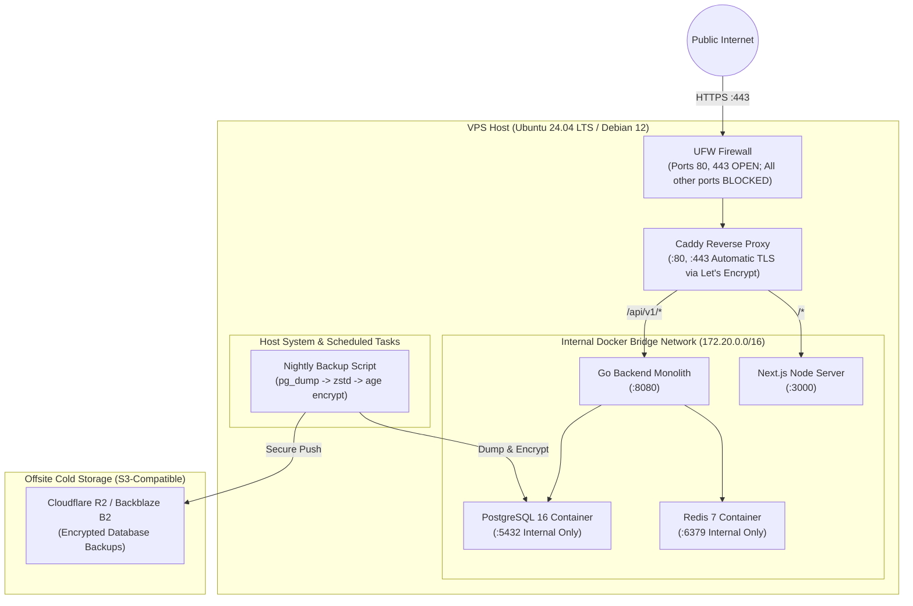

# Deployment & Operations Guide — Adaptive DSA Interview Preparation Platform

## 1. Deployment Philosophy & Budget Constraints

The platform is designed to be **cost-efficient, reproducible, and operationally simple**:
1. **Low Cost**: The production environment runs comfortably on a single modest VPS (e.g., Hetzner CX22/CX32 at ~€4–€8/month, or DigitalOcean 2GB Droplet at ~$12/month).
2. **Zero Paid Cloud Dependencies for Local Dev**: Local development runs completely offline via Docker Compose (PostgreSQL, Redis, Go, Next.js).
3. **No Overengineered Infrastructure**: Kubernetes, service meshes, and distributed queues are strictly avoided. A Go binary + PostgreSQL + Redis + Caddy architecture provides exceptional performance and sub-millisecond response times at minimal cost.
4. **Tested Disaster Recovery**: A database backup is not considered valid until an automated restore has been verified.

---

## 2. Infrastructure Architecture (Production VPS)



### VPS Resource Budget (4GB RAM Server)
| Component | Typical Memory Usage | CPU Utilization | Port Exposure |
| :--- | :--- | :--- | :--- |
| **Caddy Web Server** | ~30 MB | < 1% | **Public**: 80, 443 |
| **Go Backend Monolith** | ~45 MB | 1–5% | Internal: 8080 |
| **Next.js Frontend Server** | ~140 MB | 2–8% | Internal: 3000 |
| **PostgreSQL 16** | ~250–500 MB | 2–10% | **Internal Only**: 5432 |
| **Redis 7** | ~35 MB | < 1% | **Internal Only**: 6379 |
| **Host OS & Buffers** | ~500 MB | 1% | SSH: 22 (Key-only) |
| **Total Footprint** | **~1.1 GB / 4.0 GB** | **Plenty of Headroom** | **Minimal Surface** |

---

## 3. Local Development Setup (Docker Compose)

The local environment mirrors production architecture without requiring external accounts or paid API keys.

### 3.1. `docker-compose.yml` (Foundation)
```yaml
version: '3.8'

services:
  postgres:
    image: postgres:16-alpine
    container_name: dsa-postgres
    restart: unless-stopped
    environment:
      POSTGRES_USER: dsa_user
      POSTGRES_PASSWORD: dsa_password
      POSTGRES_DB: dsa_db
    ports:
      - "5432:5432"
    volumes:
      - pgdata:/var/lib/postgresql/data
    healthcheck:
      test: ["CMD-SHELL", "pg_isready -U dsa_user -d dsa_db"]
      interval: 5s
      timeout: 5s
      retries: 5

  redis:
    image: redis:7-alpine
    container_name: dsa-redis
    restart: unless-stopped
    ports:
      - "6379:6379"
    volumes:
      - redisdata:/data
    healthcheck:
      test: ["CMD", "redis-cli", "ping"]
      interval: 5s
      timeout: 5s
      retries: 5

volumes:
  pgdata:
  redisdata:
```

### 3.2. Running Locally
```bash
# 1. Start local infrastructure
docker compose up -d

# 2. Run database migrations
go run cmd/migrate/main.go up

# 3. Start Go backend with live reload (or go run)
go run cmd/server/main.go

# 4. Start Next.js frontend (in separate terminal)
cd web && npm run dev
```

---

## 4. Reverse Proxy Configuration (Caddy)

Caddy provides automatic HTTPS management (Let's Encrypt / ZeroSSL), HTTP/2, TLS 1.3, and reverse proxying with concise configuration.

### `Caddyfile` Production Specification
```caddy
adaptive-dsa.com, www.adaptive-dsa.com {
    encode zstd gzip

    # Security headers
    header {
        Strict-Transport-Security "max-age=31536000; includeSubDomains; preload"
        X-Content-Type-Options "nosniff"
        X-Frame-Options "DENY"
        Referrer-Policy "strict-origin-when-cross-origin"
        Permissions-Policy "camera=(), microphone=(), geolocation=()"
    }

    # API and Backend routes
    handle /api/* {
        reverse_proxy localhost:8080 {
            header_up X-Real-IP {remote_host}
            header_up X-Forwarded-For {remote_host}
            header_up X-Forwarded-Proto {scheme}
        }
    }

    # Next.js Frontend routes
    handle {
        reverse_proxy localhost:3000
    }
}
```

---

## 5. Automated Database Backup & Disaster Recovery

### 5.1. Backup Pipeline (`scripts/backup-db.sh`)
```bash
#!/usr/bin/env bash
set -euo pipefail

BACKUP_DIR="/var/backups/postgres"
TIMESTAMP=$(date +"%Y%m%d_%H%M%S")
FILENAME="dsa_db_${TIMESTAMP}.sql.zst.age"
LOCAL_PATH="${BACKUP_DIR}/${FILENAME}"

mkdir -p "${BACKUP_DIR}"

# 1. Dump database, compress with zstd, encrypt with age public key
docker exec -t dsa-postgres pg_dump -U dsa_user -d dsa_db --clean --if-exists \
  | zstd -3 \
  | age -r "age1yourpublickey..." > "${LOCAL_PATH}"

# 2. Upload to Cloudflare R2 / S3
aws s3 cp "${LOCAL_PATH}" "s3://dsa-backups/daily/${FILENAME}" \
  --endpoint-url "https://<account-id>.r2.cloudflarestorage.com"

# 3. Retain only last 7 days locally
find "${BACKUP_DIR}" -type f -name "*.age" -mtime +7 -delete

echo "Backup successful: ${FILENAME}"
```

### 5.2. Disaster Recovery & Restoration Verification
A documented restore test is performed to verify data integrity:
```bash
# 1. Download backup
aws s3 cp "s3://dsa-backups/daily/dsa_db_latest.sql.zst.age" ./restore.age \
  --endpoint-url "https://<account-id>.r2.cloudflarestorage.com"

# 2. Decrypt with private key
age -d -i ~/.age/backup_key.txt ./restore.age | zstd -d > ./restore.sql

# 3. Restore to test container
docker exec -i dsa-test-postgres psql -U dsa_user -d dsa_test < ./restore.sql

# 4. Verify table row counts
docker exec -i dsa-test-postgres psql -U dsa_user -d dsa_test -c "SELECT count(*) FROM questions;"
```

---

## 6. Infrastructure as Code (Terraform for VPS)

In Phase 6, a minimal Terraform module will provision the server and DNS records reproducibly:
- **Cloud Provider**: Hetzner Cloud (`hcloud`) or DigitalOcean (`digitalocean`).
- **Resources**:
  - 1x VPS (`CX22` / 2 vCPU, 4GB RAM, 40GB NVMe).
  - 1x Floating IP / Elastic IP.
  - DNS A and CNAME records pointing `adaptive-dsa.com` to the server IP.
  - Cloud firewall rules allowing only ports 22, 80, and 443.

---

## 7. Observability & Operational Health

### Health Check Endpoints
- `GET /healthz`: Liveness check (returns `200 OK` if Go HTTP process is responding).
- `GET /readyz`: Readiness check (verifies active `pgxpool.Ping()` and Redis `PING`). Returns `503 Service Unavailable` if database is unreachable, removing the instance from traffic routing.

### Structured Logging & Metrics
- Logs are written to `stdout` in JSON format using Go's `log/slog`.
- Docker logs are captured by `systemd-journald` with automatic log rotation (max 100MB per file, 3 backups).
- Key operational metrics monitored:
  - HTTP 5xx error rate.
  - Database pool saturation (`AcquireDuration`, `IdleConns`, `TotalConns`).
  - Webhook processing latency and duplicate event counts.
  - AI request token counts and error rates.
