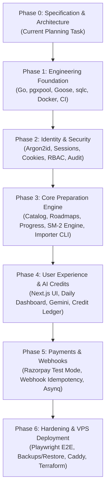

# Phased Implementation Plan & Dependency Graph — Adaptive DSA Interview Preparation Platform

## 1. Overview & Execution Strategy

This implementation plan breaks the project into **six sequential, dependency-aware phases**.
Each phase delivers a **verifiable vertical slice** with testable acceptance criteria. No phase begins until the previous phase's automated tests and quality gates pass.

---

## 2. Phase Breakdown & Acceptance Criteria

### Phase 0: Specification & Architecture (CURRENT MILESTONE)
*Objective*: Inspect workspace, establish product requirements, design database schema, formulate threat model, design import process, and create architectural documentation.
- [x] Workspace inspection (verified clean/empty state).
- [x] Create `docs/PRODUCT_SPEC.md` (Product vision, user personas, learning loop, non-goals).
- [x] Create `docs/ARCHITECTURE.md` (Modular monolith, package layout, request flows, cross-cutting concerns).
- [x] Create `docs/DATABASE_DESIGN.md` (PostgreSQL physical schema, UUIDv7, invariants, locking).
- [x] Create `docs/SECURITY.md` (STRIDE threat model, Argon2id, session cookies, payment & AI safeguards).
- [x] Create `docs/TESTING.md` (Testing pyramid, unit/integration/E2E test suites, CI gates).
- [x] Create `docs/DEPLOYMENT.md` (Docker Compose, VPS layout, automated backup/restore, Caddy).
- [x] Create `docs/AI_AND_CREDIT_MODEL.md` (Gemini abstraction, rate limits, double-entry credit ledger).
- [x] Create `docs/QUESTION_BANK_IMPORT.md` (Excel import process, duplicate detection, CLI dry-run strategy).
- [x] Create `docs/decisions/` ADRs 0001 through 0006.
- [x] **Milestone Gate**: Stop and wait for user review and approval before writing any application code.

---

### Phase 1: Engineering Foundation
*Objective*: Establish a production-grade Go project skeleton, configuration management, database connectivity, migrations, code generation, and CI automation.
- **Tasks**:
  1. Initialize Go module (`go mod init`).
  2. Implement `internal/config`: Type-safe environment variable parsing with validation using `caarlos0/env/v11` or standard library.
  3. Implement `internal/platform/logger`: Structured JSON logging via Go's standard `log/slog` with request ID propagation.
  4. Configure PostgreSQL connection pooling using `pgxpool` with health checks, connection limits, and graceful shutdown.
  5. Setup `goose` migration runner (`cmd/migrate/main.go`) and create the initial migration file `migrations/00001_initial_schema.sql`.
  6. Configure `sqlc.yaml` and verify type-safe Go code generation from SQL queries.
  7. Implement HTTP server with router (`chi/v5` or standard library `net/http` 1.22+ mux), graceful shutdown, `/healthz`, and `/readyz` endpoints.
  8. Create `docker-compose.yml` for local PostgreSQL 16 and Redis 7.
  9. Establish GitHub Actions workflow (`.github/workflows/ci.yml`) for `golangci-lint` and `go test`.
- **Learning Highlights**:
  - Tuning `pgxpool` connection pools (MaxConns, MinConns, MaxConnLifetime) to prevent connection leaks.
  - Compile-time type safety with `sqlc` versus runtime ORM errors.
  - Signal handling (`os.Interrupt`, `syscall.SIGTERM`) and graceful HTTP shutdown.
- **Milestone Acceptance Criteria**:
  - `docker compose up -d` starts PostgreSQL and Redis with clean health checks.
  - `go run cmd/migrate/main.go up` runs migration without error.
  - `sqlc generate` runs cleanly.
  - `curl -i http://localhost:8080/readyz` returns HTTP 200 with DB ping confirmation.
  - CI workflow runs and passes in GitHub Actions.

---

### Phase 2: Identity & Security (COMPLETED)
*Objective*: Implement robust authentication, server-side session management, role-based authorization, and administrative audit logging.
- [x] Implement password hashing service using Argon2id with OWASP-recommended parameters (64MB memory, 3 iterations, 2 parallelism, 16-byte salt).
- [x] Implement user registration (`POST /api/v1/auth/register`), login (`POST /api/v1/auth/login`), logout (`POST /api/v1/auth/logout`), and profile (`GET /api/v1/auth/me`).
- [x] Implement session service: Generates 32-byte cryptographically random tokens, stores SHA-256 hashes in PostgreSQL `sessions` table, sets `HttpOnly`, `SameSite=Lax` cookies.
- [x] Implement session rotation on login and privilege change; implement single session logout and invalidation.
- [x] Implement session-bound HMAC-SHA256 Anti-CSRF protection on state-changing requests.
- [x] Build authentication and authorization middleware (`Authenticate`, `RequireAuth`, `RequireRole(RoleAdmin)`, `RequireCSRF`).
- [x] Implement dedicated operator CLI tool for secure admin account provisioning (`go run cmd/admin/main.go create`).
- [x] Implement `audit_logs` repository and queries for recording sensitive security events (registration, login, logout, admin provisioning).
- [x] Apply database migration `00002_identity_and_sessions.sql` and compile type-safe queries via `sqlc`.
- [x] Implement in-memory sliding window rate limiting on authentication endpoints.
- [x] Build comprehensive automated test suite (Argon2id, session lifecycle, CSRF tokens, RBAC boundaries, duplicate rejection).
- **Milestone Gate**: Phase 2 fully implemented and verified. Ready for user review before proceeding to Phase 3.

---

### Phase 3: Core Preparation Engine & Question Bank Importer (COMPLETED)
*Objective*: Implement the curated question catalog, hierarchical patterns, master and personalized roadmaps, canonical user progress, attempt logging, spaced repetition engine, and the question bank importer CLI.
- [x] Create forward Goose migration `00003_core_preparation_engine.sql` defining enums, `topics`, `patterns`, `questions`, `question_patterns`, `question_prerequisites`, `companies`, `question_company_evidence`, `roadmaps`, `roadmap_items`, `user_question_progress`, `question_attempts`, and `revision_schedules`.
- [x] Implement sqlc query specifications for catalog (`internal/database/queries/catalog.sql`) and progress tracking (`internal/database/queries/progress.sql`) and compile type-safe Go queries.
- [x] Implement catalog domain models, slugification, and URL normalization (`internal/catalog/domain.go`).
- [x] Implement catalog repository with PostgreSQL and high-speed in-memory implementations (`internal/catalog/repository.go`).
- [x] Implement catalog application service layer for question filtering, pattern mapping, and roadmaps (`internal/catalog/service.go`).
- [x] Implement progress and spaced repetition (SM-2) domain logic (`internal/progress/domain.go`).
- [x] Implement progress repository with PostgreSQL and in-memory implementations (`internal/progress/repository.go`).
- [x] Implement atomic progress service tracking attempts, updating canonical cross-roadmap progress, and scheduling spaced reviews (`internal/progress/service.go`).
- [x] Implement Excel question bank importer package (`internal/catalog/importer`) with schema validation, URL normalization, dry-run mode, and idempotent transactional commit.
- [x] Implement question bank importer CLI command (`cmd/import-questions/main.go`) supporting `--file`, `--dry-run`, `--commit`, and `--confirm-prod` production safeguards.
- [x] Implement HTTP handlers for catalog (`/api/v1/questions`, `/api/v1/topics`, `/api/v1/roadmaps`) and progress (`/api/v1/questions/{id}/attempts`, `/api/v1/progress`, `/api/v1/revisions/due`).
- [x] Generate small, clearly labeled test fixture spreadsheet (`testdata/sample_questions.xlsx`) conforming to documented contract.
- [x] Build comprehensive test suite verifying SM-2 scheduling, attempt history preservation, cross-roadmap progress sharing, importer dry-run and idempotency, and HTTP endpoint authorization.
- [x] Update Makefile and GitHub Actions CI workflow to build all 4 application binaries.
- **Milestone Gate**: Phase 3 fully implemented and verified. Ready for user review before proceeding to Phase 4.

---

### Phase 4: User Experience, Daily Dashboard & AI Credits
*Objective*: Build the daily preparation dashboard engine, AI tutoring provider, progressive hint ladder, append-only immutable credit ledger, adaptive recommendation system, and complete Next.js user-facing experience.
- **Tasks**:
  - [x] Implement deterministic Adaptive Preparation Engine (`internal/adaptive`) prioritizing due SM-2 revisions, weak pattern reinforcement, and roadmap milestones.
  - [x] Implement AI Provider abstraction and Google Gemini REST client (`internal/ai`) with prompt injection protection (XML delimiters).
  - [x] Implement Progressive Hint Ladder (Level 1 Nudge to Level 4 Pseudocode), Approach Review, and Concept Explanation.
  - [x] Implement append-only immutable credit ledger (`credit_ledger_entries`, `credit_accounts`) with row-level locking (`SELECT ... FOR UPDATE`), zero-charge failure guarantee, refunds, and reconciliation verification.
  - [x] Implement Admin promotional credit grants (`POST /api/v1/admin/users/{id}/credits`) with audit logs.
  - [x] Implement HTTP API endpoints for adaptive dashboard, weak patterns, AI hints, approach reviews, and credit balances.
  - [x] Complete Next.js 16+ frontend application (`web/`) with TypeScript, Tailwind CSS, lucide-react, session cookies, and CSRF double-submit protection.
  - [x] Implement user-facing pages:
    - Daily Preparation Dashboard (`/dashboard`) with adaptive priority queue, SM-2 retention stats, weak pattern diagnostics, and recent attempt history.
    - Question Catalog (`/questions`) with search, difficulty filtering, and pattern tags.
    - Practice Workspace (`/questions/[id]`) with live interview timer, 4-tier progressive hint ladder, code approach review, concept Q&A, and full attempt logging modal (outcome, perceived difficulty, quality stars, mistake taxonomy).
    - Spaced Repetition Due Queue (`/revisions`) with overdue indicators, stability metrics, and instant solve links.
    - Credit Ledger & History (`/credits`) with available balance card, zero-charge guarantee badge, and immutable transaction ledger table.
    - System Administration (`/admin`) for promotional credit grants and runtime audit verification.
    - Authentication (`/login`, `/register`, `/`) with promotional bonus callout and secure CSRF-protected forms (zero invented demo credentials).
  - [x] Run comprehensive automated verification: frontend production build, ESLint, TypeScript check, unit tests, and real PostgreSQL 16 integration tests across all 13 Go packages.
- **Milestone Acceptance Criteria**:
  - [x] Requesting an AI hint checks balance, reserves credits, calls Gemini, and deducts credits atomically.
  - [x] Simulated Gemini timeout or failure leaves user credit balance untouched (0 charge).
  - [x] Admin can grant promotional credits with a documented reason, producing an immutable ledger record and audit log.
  - [x] Adaptive preparation engine deterministically ranks due SM-2 revisions ahead of weak patterns and roadmap steps.
  - [x] Full Next.js frontend builds without errors and connects to all Go backend APIs.
- **Status**: Phase 4 Complete & Live Gemini Verified (Frontend + Backend + AI Engine + Real PostgreSQL 16 + Live Gemini API Verified). Ready for User Review. Stopped before Phase 5.

---

### Phase 5: Payments & Background Worker
*Objective*: Implement Razorpay test-mode payment gateway integration, checkout flow, HMAC signature verification, idempotent webhook handling, and atomic credit delivery.
- **Tasks**:
  - [x] Payment provider abstraction (`PaymentProvider` interface) decoupling Razorpay-specific API logic from application domain.
  - [x] Server-side credit packages and pricing configuration in integer INR paise (`pkg_starter`: 50 cr / ₹99, `pkg_pro`: 150 cr / ₹249, `pkg_master`: 400 cr / ₹599).
  - [x] Server-side payment order creation (`POST /api/v1/payments/orders`) enforcing server prices; rejects client-supplied amounts or credit quantities.
  - [x] Razorpay Checkout integration in Next.js frontend with dynamic script loader, interactive tier cards, pending/verifying/success/failure states, and live credit balance reconciliation.
  - [x] Client checkout signature verification endpoint (`POST /api/v1/payments/verify`) using HMAC-SHA256 with constant-time equality check (`crypto/subtle.ConstantTimeCompare`).
  - [x] Razorpay webhook endpoint (`POST /api/v1/payments/webhook`) verifying `X-Razorpay-Signature` against raw body with constant-time comparison.
  - [x] Webhook event deduplication and replay protection via `payment_webhook_events` table (`event_id UNIQUE`).
  - [x] Atomic credit delivery in a single PostgreSQL transaction: row lock (`SELECT ... FOR UPDATE`), status transition to `PAID`, immutable `credit_ledger` entry with `ReferenceType: "RAZORPAY_PAYMENT"`, and materialized balance update.
  - [x] Reversible Goose database migration `migrations/00005_payments_and_webhooks.sql` adding `payment_orders`, `payment_webhook_events`, and `background_jobs`.
  - [x] Durable PostgreSQL-backed background worker (`Worker`) with `FOR UPDATE SKIP LOCKED` batch polling, exponential backoff, and bounded retry limits.
  - [x] User payment history endpoint (`GET /api/v1/payments/history`) and admin payment audit listing (`GET /api/v1/admin/payments`) with existing RBAC enforcement.
  - [x] Comprehensive automated test suite: PostgreSQL 16 integration tests for concurrent checkout/webhook delivery, duplicate deliveries, worker bounded retries, and ledger reconciliation; server API unit and integration tests.
- **Learning Highlights**:
  - Why client-side payment callbacks must never be trusted for granting value.
  - Idempotent webhook processing in high-concurrency environments using database constraints and row locking.
  - Double-entry ledger balance reconciliation audits (`SUM(ledger) == cached_balance`).
- **Milestone Acceptance Criteria**:
  - [x] Valid Razorpay webhook results in order marked `PAID` and exact credit amount added to ledger.
  - [x] Invalid signature returns HTTP 400 with zero database changes.
  - [x] Sending the identical webhook payload 10 times concurrently results in exactly **one** credit grant entry in `credit_ledger`.
  - [x] Concurrent checkout verification and webhook delivery against the same payment order do not produce race conditions or duplicate credits.
  - [x] Full Next.js frontend builds without errors and connects to all payments Go backend APIs.
- **Status**: Phase 5 Complete & Audited (Backend + Real PostgreSQL 16 Concurrency Verified + Frontend Next.js Production Build + Webhook Idempotency + Durable Worker). Ready for User Review. Stopped before Phase 6.

---

### Phase 6: Hardening, Observability & VPS Deployment
*Objective*: Execute end-to-end integration testing, security audit, database backup/restore verification, containerization, and prepare for controlled release review.
- **Tasks**:
  - [x] Multi-stage non-root Dockerfile for Go API monolith (`Dockerfile`) building statically stripped binaries (`server`, `migrate`, `admin`, `import-questions`) running under `appuser:10001`.
  - [x] Multi-stage standalone Dockerfile for Next.js frontend (`web/Dockerfile`) with `output: "standalone"` running under `nextjs:1001`.
  - [x] Production Docker Compose configuration (`docker-compose.yml`) with internal-only private PostgreSQL network, resource limits, healthchecks, and Caddy reverse proxy (`Caddyfile`).
  - [x] Dedicated local evaluation compose stack (`docker-compose.local.yml`) allowing single-command local testing with zero external credential dependencies.
  - [x] Security hardening: Security headers middleware (HSTS, CSP, X-Frame-Options, Referrer-Policy, Permissions-Policy), `http.MaxBytesReader` body limits, CORS whitelist enforcement, and production startup config validation.
  - [x] PostgreSQL role separation and append-only hardening (`scripts/setup_production_roles.sql`) with migrator DDL account vs unprivileged application DML account, revoking `UPDATE` and `DELETE` on ledger and audit tables.
  - [x] Automated compressed database backup and restore scripts (`scripts/backup_postgres.sh`, `scripts/restore_postgres.sh`) with SHA-256 verification and 7-day retention.
  - [x] Live PostgreSQL 16 restore test executed and verified (compressed dump, created clean disposable DB, restored 23/23 tables and migrations, verified schema, dropped clean DB).
  - [x] Operational diagnostics & metrics endpoint (`GET /api/v1/admin/metrics`) protected by Admin RBAC reporting runtime, DB pool, and background worker queue metrics.
  - [x] Double-entry credit ledger balance reconciliation CLI tool (`go run ./cmd/admin reconcile-credits`) and operational runbooks (`docs/runbooks/OPERATIONS.md`).
  - [x] Razorpay test-mode guide (`docs/PAYMENTS_TEST_MODE_GUIDE.md`) detailing local webhook tunneling, test cards, and failure flows.
  - [x] GitHub Actions CI/CD workflows: `.github/workflows/ci.yml` (Go tests with race detection against PostgreSQL 16, Next.js lint/build, Docker container build verification) and `.github/workflows/deploy.yml` (manual dispatch with approval gates).
- **Milestone Acceptance Criteria**:
  - [x] All Go unit and PostgreSQL integration tests pass with race detection.
  - [x] Next.js frontend builds without errors in standalone production mode.
  - [x] Automated restore test successfully reconstructs database from backup and asserts all 23 table counts and goose migrations.
  - [x] Health check endpoints (`/healthz`, `/readyz`) and administrative metrics (`/api/v1/admin/metrics`) operational.
  - [x] All test credentials remain safely isolated; zero live payment credentials enabled.
  - [x] Local Docker Compose execution verified with step-by-step user evaluation guide.
- **Status**: Phase 6 Complete & Hardened.

---

### Release 1: Product Completion & Full Workflow Audit
*Objective*: Transform all completed foundational phases into a cohesive, fully connected, production-quality Release 1 product with all 20 specification areas verified.
- **Tasks**:
  - [x] **Frontend Reverse Proxy & Cookie Delivery**: Next.js route handler proxying `/api/v1/*` to `http://backend:8080` preserving both `session_token` and `csrf_token` via `getSetCookie()`.
  - [x] **Welcome Credit Grant**: Atomic 50 promotional credit grant on user registration and balance retrieval into signed double-entry ledger.
  - [x] **Onboarding Flow & Persistence**: Migration 00007 (`user_profiles`), interactive 6-step wizard at `/onboarding` with goals, timeline, and company preferences.
  - [x] **Curated & Company Roadmaps**: 5 seeded roadmaps in PostgreSQL (Master 29 Patterns, Blind 75, Google, Meta, Amazon) with canonical question identity across tracks.
  - [x] **Practice Workspace & Attempts**: Practice timer, outcome tracking (`SOLVED_INDEPENDENTLY`, `HINTS_USED`, `EDITORIAL_USED`, `FAILED`), notes, mistake tags, and code snippets at `/questions/[id]`.
  - [x] **SM-2 Spaced Repetition**: Next review scheduling, interval days, and ease factor calculations surfaced in `/revisions`.
  - [x] **AI Tutor & Authoritative Pricing**: 4-level progressive hint ladder, approach review, concept explanation, 0 charge on failures, and offline mock support (`USE_MOCK_AI=true`).
  - [x] **Razorpay Mock Payment Checkout**: Starter (50cr / ₹99), Pro (150cr / ₹249), Master (400cr / ₹599) packages with authoritative server-side pricing and idempotent fulfillment.
  - [x] **Data Portability**: JSON export of candidate attempts, progress, and SM-2 schedules (`GET /api/v1/user/export`) via `/dashboard`.
  - [x] **Code Quality & Automated Verification**: 0 ESLint errors/warnings, Next.js production build clean, Go unit and integration test suite passing (0 failures), automated 10-gate E2E journey test verified.
- **Status**: Release 1 Complete, Fully Connected, Audited, and Verified Locally.

