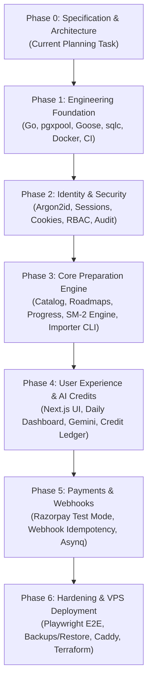

# Phased Implementation Plan & Dependency Graph — Adaptive DSA Interview Preparation Platform

## 1. Overview & Execution Strategy

This implementation plan breaks the project into **six sequential, dependency-aware phases**.
Each phase delivers a **verifiable vertical slice** with testable acceptance criteria. No phase begins until the previous phase's automated tests and quality gates pass.

---

## 2. Phase Breakdown & Acceptance Criteria

### Phase 0: Specification & Architecture (CURRENT MILESTONE)
*Objective*: Inspect workspace, establish product requirements, design database schema, formulate threat model, design import process, and create architectural documentation.
- [x] Workspace inspection (verified clean/empty state).
- [x] Create `docs/PRODUCT_SPEC.md` (Product vision, user personas, learning loop, non-goals).
- [x] Create `docs/ARCHITECTURE.md` (Modular monolith, package layout, request flows, cross-cutting concerns).
- [x] Create `docs/DATABASE_DESIGN.md` (PostgreSQL physical schema, UUIDv7, invariants, locking).
- [x] Create `docs/SECURITY.md` (STRIDE threat model, Argon2id, session cookies, payment & AI safeguards).
- [x] Create `docs/TESTING.md` (Testing pyramid, unit/integration/E2E test suites, CI gates).
- [x] Create `docs/DEPLOYMENT.md` (Docker Compose, VPS layout, automated backup/restore, Caddy).
- [x] Create `docs/AI_AND_CREDIT_MODEL.md` (Gemini abstraction, rate limits, double-entry credit ledger).
- [x] Create `docs/QUESTION_BANK_IMPORT.md` (Excel import process, duplicate detection, CLI dry-run strategy).
- [x] Create `docs/decisions/` ADRs 0001 through 0006.
- [x] **Milestone Gate**: Stop and wait for user review and approval before writing any application code.

---

### Phase 1: Engineering Foundation
*Objective*: Establish a production-grade Go project skeleton, configuration management, database connectivity, migrations, code generation, and CI automation.
- **Tasks**:
  1. Initialize Go module (`go mod init`).
  2. Implement `internal/config`: Type-safe environment variable parsing with validation using `caarlos0/env/v11` or standard library.
  3. Implement `internal/platform/logger`: Structured JSON logging via Go's standard `log/slog` with request ID propagation.
  4. Configure PostgreSQL connection pooling using `pgxpool` with health checks, connection limits, and graceful shutdown.
  5. Setup `goose` migration runner (`cmd/migrate/main.go`) and create the initial migration file `migrations/00001_initial_schema.sql`.
  6. Configure `sqlc.yaml` and verify type-safe Go code generation from SQL queries.
  7. Implement HTTP server with router (`chi/v5` or standard library `net/http` 1.22+ mux), graceful shutdown, `/healthz`, and `/readyz` endpoints.
  8. Create `docker-compose.yml` for local PostgreSQL 16 and Redis 7.
  9. Establish GitHub Actions workflow (`.github/workflows/ci.yml`) for `golangci-lint` and `go test`.
- **Learning Highlights**:
  - Tuning `pgxpool` connection pools (MaxConns, MinConns, MaxConnLifetime) to prevent connection leaks.
  - Compile-time type safety with `sqlc` versus runtime ORM errors.
  - Signal handling (`os.Interrupt`, `syscall.SIGTERM`) and graceful HTTP shutdown.
- **Milestone Acceptance Criteria**:
  - `docker compose up -d` starts PostgreSQL and Redis with clean health checks.
  - `go run cmd/migrate/main.go up` runs migration without error.
  - `sqlc generate` runs cleanly.
  - `curl -i http://localhost:8080/readyz` returns HTTP 200 with DB ping confirmation.
  - CI workflow runs and passes in GitHub Actions.

---

### Phase 2: Identity & Security (COMPLETED)
*Objective*: Implement robust authentication, server-side session management, role-based authorization, and administrative audit logging.
- [x] Implement password hashing service using Argon2id with OWASP-recommended parameters (64MB memory, 3 iterations, 2 parallelism, 16-byte salt).
- [x] Implement user registration (`POST /api/v1/auth/register`), login (`POST /api/v1/auth/login`), logout (`POST /api/v1/auth/logout`), and profile (`GET /api/v1/auth/me`).
- [x] Implement session service: Generates 32-byte cryptographically random tokens, stores SHA-256 hashes in PostgreSQL `sessions` table, sets `HttpOnly`, `SameSite=Lax` cookies.
- [x] Implement session rotation on login and privilege change; implement single session logout and invalidation.
- [x] Implement session-bound HMAC-SHA256 Anti-CSRF protection on state-changing requests.
- [x] Build authentication and authorization middleware (`Authenticate`, `RequireAuth`, `RequireRole(RoleAdmin)`, `RequireCSRF`).
- [x] Implement dedicated operator CLI tool for secure admin account provisioning (`go run cmd/admin/main.go create`).
- [x] Implement `audit_logs` repository and queries for recording sensitive security events (registration, login, logout, admin provisioning).
- [x] Apply database migration `00002_identity_and_sessions.sql` and compile type-safe queries via `sqlc`.
- [x] Implement in-memory sliding window rate limiting on authentication endpoints.
- [x] Build comprehensive automated test suite (Argon2id, session lifecycle, CSRF tokens, RBAC boundaries, duplicate rejection).
- **Milestone Gate**: Phase 2 fully implemented and verified. Ready for user review before proceeding to Phase 3.

---

### Phase 3: Core Preparation Engine & Question Bank Importer (COMPLETED)
*Objective*: Implement the curated question catalog, hierarchical patterns, master and personalized roadmaps, canonical user progress, attempt logging, spaced repetition engine, and the question bank importer CLI.
- [x] Create forward Goose migration `00003_core_preparation_engine.sql` defining enums, `topics`, `patterns`, `questions`, `question_patterns`, `question_prerequisites`, `companies`, `question_company_evidence`, `roadmaps`, `roadmap_items`, `user_question_progress`, `question_attempts`, and `revision_schedules`.
- [x] Implement sqlc query specifications for catalog (`internal/database/queries/catalog.sql`) and progress tracking (`internal/database/queries/progress.sql`) and compile type-safe Go queries.
- [x] Implement catalog domain models, slugification, and URL normalization (`internal/catalog/domain.go`).
- [x] Implement catalog repository with PostgreSQL and high-speed in-memory implementations (`internal/catalog/repository.go`).
- [x] Implement catalog application service layer for question filtering, pattern mapping, and roadmaps (`internal/catalog/service.go`).
- [x] Implement progress and spaced repetition (SM-2) domain logic (`internal/progress/domain.go`).
- [x] Implement progress repository with PostgreSQL and in-memory implementations (`internal/progress/repository.go`).
- [x] Implement atomic progress service tracking attempts, updating canonical cross-roadmap progress, and scheduling spaced reviews (`internal/progress/service.go`).
- [x] Implement Excel question bank importer package (`internal/catalog/importer`) with schema validation, URL normalization, dry-run mode, and idempotent transactional commit.
- [x] Implement question bank importer CLI command (`cmd/import-questions/main.go`) supporting `--file`, `--dry-run`, `--commit`, and `--confirm-prod` production safeguards.
- [x] Implement HTTP handlers for catalog (`/api/v1/questions`, `/api/v1/topics`, `/api/v1/roadmaps`) and progress (`/api/v1/questions/{id}/attempts`, `/api/v1/progress`, `/api/v1/revisions/due`).
- [x] Generate small, clearly labeled test fixture spreadsheet (`testdata/sample_questions.xlsx`) conforming to documented contract.
- [x] Build comprehensive test suite verifying SM-2 scheduling, attempt history preservation, cross-roadmap progress sharing, importer dry-run and idempotency, and HTTP endpoint authorization.
- [x] Update Makefile and GitHub Actions CI workflow to build all 4 application binaries.
- **Milestone Gate**: Phase 3 fully implemented and verified. Ready for user review before proceeding to Phase 4.

---

### Phase 4: User Experience, Daily Dashboard & AI Credits
*Objective*: Build the responsive Next.js frontend, daily preparation dashboard, attempt logging modal, revision queue, Gemini AI tutor integration, and double-entry credit ledger.
- **Tasks**:
  1. Initialize Next.js 14+ (App Router) project with TypeScript, Tailwind CSS, and shadcn/ui components.
  2. Implement authentication flow in frontend (Login, Register, Session context, Protected routes).
  3. Build Daily Dashboard: Today's focus, due revisions, weak pattern indicators, streak metrics.
  4. Build Question Catalog view with pattern filtering, search, and difficulty tags.
  5. Build Attempt Logging Modal: Outcome selection, timer, mistake taxonomy checkboxes, notes.
  6. Implement AI Provider abstraction and Google Gemini client (`internal/ai`).
  7. Implement Progressive Hint Ladder component (Level 1 Nudge to Level 4 Pseudocode).
  8. Implement double-entry credit ledger (`credit_ledger_entries`, `credit_accounts`) with row-level locking (`SELECT ... FOR UPDATE`).
  9. Implement Admin Panel: User lookup, catalog management, manual promotional credit grants with audit logs.
- **Learning Highlights**:
  - Avoiding frontend state duplication: Backend remains the single source of truth for business rules.
  - Safe prompt engineering and injection defense using XML delimiter isolation.
  - Implementing double-entry accounting in PostgreSQL to ensure financial consistency under concurrency.
- **Milestone Acceptance Criteria**:
  - User can register, log in, view their daily study plan, and log a question attempt via the browser UI.
  - Requesting an AI hint checks balance, displays estimated credit cost, reserves credits, calls Gemini, and deducts credits atomically.
  - Simulated Gemini timeout or failure leaves user credit balance untouched (0 charge).
  - Admin can grant promotional credits with a documented reason, producing an immutable ledger record and audit log.

---

### Phase 5: Payments & Background Worker
*Objective*: Implement Razorpay test-mode payment gateway integration, checkout flow, HMAC signature verification, idempotent webhook handling, and atomic credit delivery.
- **Tasks**:
  1. Implement server-side Razorpay order creation (`POST /api/v1/payments/orders`).
  2. Implement Razorpay test-mode checkout integration in the Next.js frontend.
  3. Implement webhook handler (`POST /api/v1/payments/webhook`) with HMAC-SHA256 signature verification.
  4. Implement webhook idempotency using `payment_webhook_events` table to prevent duplicate crediting.
  5. Execute payment fulfillment in an atomic PostgreSQL transaction: Mark order `PAID`, record transaction, insert credit ledger entry, and update cached balance.
  6. Setup Redis-backed background worker (`asynq` or simple worker pool) for asynchronous email notifications and nightly reconciliation tasks.
  7. Implement nightly ledger reconciliation check (`SUM(ledger) == cached_balance`).
- **Learning Highlights**:
  - Why client-side payment callbacks must never be trusted.
  - Idempotent webhook processing in high-concurrency environments.
  - Designing financial reconciliation audits in backend software.
- **Milestone Acceptance Criteria**:
  - Valid Razorpay webhook results in order marked `PAID` and exact credit amount added to ledger.
  - Invalid signature returns HTTP 400 with zero database changes.
  - Sending the identical webhook payload 3 times results in HTTP 200 responses with exactly **one** credit grant entry in `credit_ledger_entries`.
  - Concurrent webhook requests do not produce race conditions.

---

### Phase 6: Hardening, Observability & VPS Deployment
*Objective*: Execute end-to-end integration testing, security audit, database backup/restore verification, Terraform provisioning, and live deployment on a modest VPS.
- **Tasks**:
  1. Implement automated Playwright end-to-end test suite for critical candidate workflows.
  2. Execute security hardening: CORS audit, Content Security Policy (CSP), rate limit tuning, dependency vulnerability scan (`govulncheck`, `npm audit`).
  3. Implement automated database backup script (`pg_dump` $\rightarrow$ `zstd` $\rightarrow$ `age` encryption $\rightarrow$ offsite S3 upload).
  4. Write and verify automated disaster recovery restore script on a clean container.
  5. Create Terraform module for provisioning a low-cost VPS (Hetzner / DigitalOcean), DNS records, and cloud firewall.
  6. Configure Caddy reverse proxy with automatic Let's Encrypt TLS.
  7. Deploy application stack via Docker Compose with systemd auto-restart.
  8. Perform smoke testing against live VPS deployment in test mode.
- **Learning Highlights**:
  - End-to-end testing of full-stack web applications.
  - Zero-cost automated database encryption and offsite cold storage.
  - Production infrastructure automation with Terraform and Caddy.
- **Milestone Acceptance Criteria**:
  - Full Playwright E2E suite passes in CI.
  - Automated restore test successfully reconstructs database from encrypted backup and asserts table counts.
  - Application runs on VPS under HTTPS with valid TLS certificate.
  - Health check endpoints (`/healthz`, `/readyz`) respond in < 10ms.
  - All test credentials remain safely isolated; zero live payment credentials enabled.
