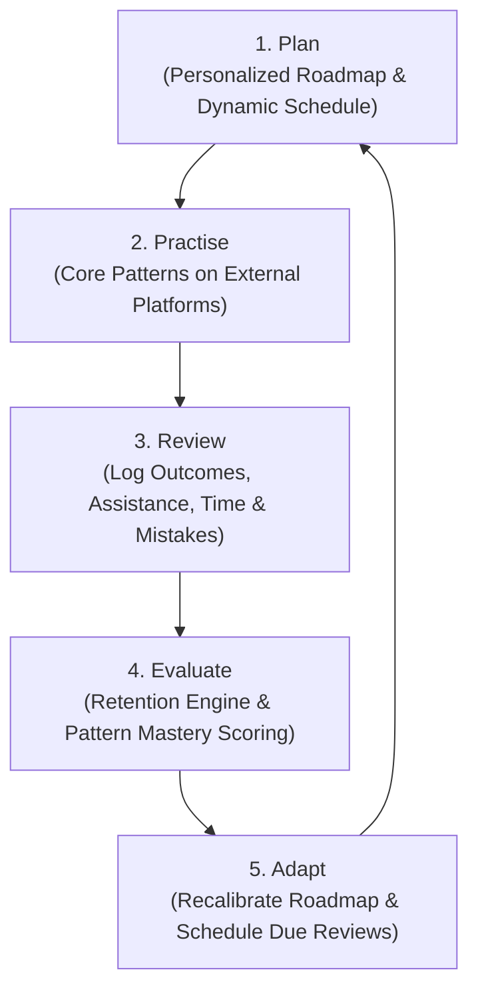

# Product Specification — Adaptive DSA Interview Preparation Platform

## 1. Executive Summary & Vision

The **Adaptive DSA Interview Preparation Platform** is an intelligent, evidence-based preparation system designed for serious software engineers targeting Tier-1 and FAANG-style tech companies (e.g., Google, Amazon, Meta).

Most existing DSA preparation solutions suffer from critical structural weaknesses:
1. **Passive Tracking**: Simple spreadsheets or LeetCode trackers act merely as static checkboxes ("Solved / Not Solved") without tracking cognitive struggle, assistance used, or time spent.
2. **Generic Question Lists**: Standard 75/150 lists treat all candidates identically, ignoring personal strengths, weak patterns, target company timelines, and memory decay.
3. **Overwhelming Revision Backlogs**: When candidates pause for a few days, static review schedules dump dozens of problems into a backlog, causing demoralization and abandonment.
4. **Unreliable AI Assistance**: Generic chatbots either hallucinate solutions immediately or provide low-quality, non-curated advice without understanding the pedagogical context of the pattern.

### The Central Learning Loop
This platform solves these problems through an active learning feedback loop:

### Honest Value Proposition & Disclaimer
The platform **never** guarantees that a candidate will receive an offer or pass a specific interview. Readiness estimates are strictly **evidence-based indicators** summarizing demonstrated independent problem-solving performance, pattern coverage, and spaced retention metrics.

---

## 2. Target Audience & Personas

| Persona | Background & Goals | Pain Points | Platform Solution |
| :--- | :--- | :--- | :--- |
| **"The Time-Crunched Mid-Level"** | 3–5 YOE SWE with an upcoming interview in 6–8 weeks. Has 1.5–2 hours/day. | Cannot solve 500 problems; needs high-leverage coverage and must focus on company-specific high-frequency patterns. | Stage-based roadmap prioritizing canonical core problems and high-yield variations; smart dynamic scheduling. |
| **"The Pattern Stumbler"** | Junior/Mid SWE who knows basic syntax and easy problems, but gets stuck on medium Dynamic Programming, Monotonic Stacks, or Graph Traversal. | Memorizes code rather than understanding recurring subpatterns; repeats identical mistakes. | Mistake taxonomy tracking; progressive hint ladder via Gemini; targeted variation drills. |
| **"The Lapsed LeetCoder"** | Solved 200 problems 6 months ago, but feels like they have forgotten everything. | Frustration at starting from scratch; does not know which solved problems have decayed. | Spaced repetition revision engine highlighting decayed problems; diagnostic onboarding skip. |

---

## 3. Onboarding & Personalization Workflow

The onboarding workflow establishes the candidate's initial baseline without forcing experienced engineers through elementary drills.

### Onboarding Steps
1. **Target Profile**:
   - Target Companies (e.g., Google, Meta, Amazon, General Tier-1).
   - Target Role & Seniority (L4/SDE-II, L5/Senior, etc.).
   - Target Interview Date (or general preparation horizon: 1 month, 3 months, 6 months).
2. **Availability**:
   - Available study time per day (e.g., 60 mins, 90 mins, 120 mins).
   - Days per week available for study (e.g., 5 days/week vs 7 days/week).
3. **Current Experience & Prior Progress**:
   - Self-assessed experience level: *Novice* (knows language syntax, new to trees/graphs), *Intermediate* (knows common patterns, struggles with hard mediums/hard), *Advanced* (aiming for speed and mastery of complex variations).
   - Known Patterns Checklist: Ability to mark entire foundational patterns as already understood (e.g., Arrays & Hashing, Two Pointers).
   - Optional Progress Import / Quick-Check: Check off previously completed canonical questions so historical credit is recognized immediately.
4. **Roadmap Generation**:
   - The engine generates a multi-stage study roadmap tailored to the target timeline and daily time budget.
   - Stage 1: Essential Pattern Foundations.
   - Stage 2: Core Interview Patterns & Variations.
   - Stage 3: Company High-Evidence Questions & Weakness Remediation.
   - Stage 4: Speed Drills & High-Stakes Final Revision.

### Schedule Recalibration Without Penalty
- Candidates can modify their daily time budget, target date, or priority topics at any time.
- The system explains the impact before applying adjustments (e.g., *"Reducing daily time from 90 to 45 mins will extend your estimated Phase 2 completion by 14 days or require deferring 18 reinforcement questions. Proceed?"*).
- Historical progress and attempt logs are **never** lost or reset when a roadmap or schedule is reconfigured.

---

## 4. Question Catalog & Master Roadmap

### Curated Master Bank (600–700 Problems)
The core problem bank is sourced from the user's curated master spreadsheet, rather than generated by uncontrolled web scraping or AI hallucination.
- **Canonical ID**: Every problem has a unique, immutable canonical ID (e.g., `q_01j7...` or UUIDv7) and a human-readable slug.
- **Canonical Sharing**: A problem has **exactly one** global canonical record and **one progress record per user**. If a problem appears in the *General FAANG Roadmap*, the *Google High-Frequency Roadmap*, and a *Custom Weakness Roadmap*, solving it in one place marks it solved across all roadmaps.
- **Problem Metadata**:
  - Title, External URL (e.g., LeetCode link).
  - Difficulty: `EASY`, `MEDIUM`, `HARD`.
  - Editorial metadata: Short concept summary, prerequisite patterns.
  - Pattern Associations: Primary pattern (e.g., `Sliding Window`) and Subpattern/Variation (e.g., `Dynamic Size - At Most K Distinct`).
  - Classification: `CORE` (must-solve canonical exemplar) vs `REINFORCEMENT` (variation for consolidation).
- **Company Evidence (Honest Provenance)**:
  - Company tags are stored **only** with explicit source provenance and evidence date (e.g., `company: Meta, source: Candidate Interview Debrief 2024-Q2, confidence: HIGH`).
  - The platform strictly forbids fabricating company frequency percentages or fake popularity numbers.

---

## 5. Daily Preparation & Practice Workflow

### Daily Preparation Dashboard
The candidate's central operating screen provides immediate daily clarity:
1. **Today's Focus**:
   - 1–2 New Roadmap Questions matching today's target pattern.
   - Due Revisions scheduled for today by the spaced repetition engine.
2. **Overdue / Missed Handling**:
   - Missed days do **not** trigger an exponential wall of overdue problems.
   - The dashboard prioritizes the most decayed and highest-value revisions to fit within today's stated time budget, gracefully rolling forward the remainder.
3. **Velocity & Streak Health**:
   - Focuses on consistency (days active, weekly goal completion) without toxic guilt mechanics.
4. **Weak Pattern Indicator**:
   - Visual badges highlighting patterns with low independent-solve rates or frequent mistake recurrence.

### Practice Tracking & Log Attempt Modal
Candidates solve problems in their preferred IDE or on external platforms (LeetCode, HackerRank, Codeforces). When finished, they record an attempt:
- **Attempt Outcome**:
  - `SOLVED_INDEPENDENTLY` (solved within target time with zero external help).
  - `SOLVED_WITH_HINTS` (solved after viewing progressive hints or nudges).
  - `SOLVED_AFTER_EDITORIAL` (understood solution after reading discussion/editorial).
  - `UNRESOLVED_FAILED` (abandoned or gave up after time expired).
- **Metrics Tracked**:
  - Time spent (minutes).
  - Perceived difficulty (`EASY`, `JUST_RIGHT`, `CHALLENGING`, `OVERWHELMING`).
  - Mistake Taxonomy:
    - *Syntax / Language quirk*
    - *Off-by-one / Edge case (empty array, null node, single element)*
    - *Incorrect time/space complexity approach*
    - *Failed to recognize underlying pattern*
    - *State transition error (DP)*
    - *Graph cycle / termination condition error*
  - Approach Notes & Code Snippet: Personal notes, alternative approaches (e.g., "O(N) space hash map vs O(1) two pointers").
  - Bookmark & Follow-up toggle.

---

## 6. Revision & Mastery Engine

The revision system is powered by an evidence-based adaptation of the SuperMemo-2 (SM-2) / FSRS spaced repetition algorithms, tailored specifically for algorithmic problem solving.

### Cognitive Scheduling Inputs
Instead of a naive fixed calendar (e.g., revise in 3 days, then 7 days):
- **Independence Weight**: `SOLVED_INDEPENDENTLY` increases interval significantly; `SOLVED_AFTER_EDITORIAL` resets interval to 1–2 days.
- **Mistake Penalty**: Severe conceptual mistakes (pattern failure) lower the item's stability score more aggressively than simple off-by-one errors.
- **Time Factor**: Solving a medium problem in 15 minutes implies higher mastery than taking 55 minutes.
- **Decay Curve**: The engine calculates an estimated retention probability $R(t) = e^{-t / S}$ where $S$ is memory stability. Items are scheduled for review when retention drops below 80%.

### Anti-Backlog Overdue Rescheduling
If a candidate steps away for a week and returns to 30 "due" questions:
- The system asks: *"You have 45 minutes today. Would you like to review the top 3 highest-impact decayed problems, or continue with your roadmap?"*
- Overdue items are triaged: high-difficulty core patterns are scheduled first; reinforcement variations are spaced out across the upcoming week.

---

## 7. AI Capabilities & Guardrails (Google Gemini)

AI serves as a tireless, pedagogical private tutor, never as an unconstrained solution generator.

### Core AI Features
1. **Progressive Hint Ladder**:
   - *Level 1 (Nudge)*: High-level intuition ("Consider how sorting the input array simplifies checking for duplicates").
   - *Level 2 (Structural Hint)*: Identifies the pattern and data structure ("Use a hash map to store elements seen so far and their indices").
   - *Level 3 (Algorithmic Invariant)*: Defines the key logic/loop invariant without writing full code.
   - *Level 4 (Pseudocode / Solution Analysis)*: Full walkthrough explaining time and space complexity.
2. **Approach & Code Review**:
   - The candidate pastes their proposed approach or code.
   - Gemini evaluates correctness, edge case handling, and asymptotic complexity without giving away unnecessary answers.
3. **Mistake Classification**:
   - Analyzes candidate notes to suggest the underlying cognitive failure category.
4. **Personalized Revision Synthesis**:
   - Summarizes past mistakes across a specific pattern before an interview (e.g., "Summary of your common pitfalls in Binary Search on Answer").

### Strict AI Safety & System Guardrails
- **Deterministic Code First**: Scheduling, mastery scoring, roadmap sequencing, and credit math are 100% deterministic Go code. AI is never trusted with business logic.
- **No Catalog Poisoning**: AI cannot create, modify, or insert canonical questions into the database.
- **Prompt Injection Defense**: User notes and code are isolated in bounded XML delimiters with strict system prompt boundaries.
- **Server-Side API Key & Secrets**: Gemini API keys never leave the Go backend.
- **Fail-Safe & Free-to-Paid Protection**:
  - Timeouts and circuit breakers prevent hanging requests.
  - If Gemini fails or times out, user credits are **never deducted**.

---

## 8. Credit System & Monetization

### Commercial Strategy
- **Core Free Tier**:
  - Full access to the curated 600–700 question master catalog.
  - Full roadmap generation, attempt logging, and spaced repetition revision engine.
  - Manual preparation tracking remains 100% free forever.
- **Paid AI Assistance (Credit Model)**:
  - Candidates purchase or earn AI credits to use pedagogical features (hints, approach reviews, code diagnostics).
  - New users receive a promotional credit grant (e.g., 50 free credits) on onboarding.
  - Additional credits are purchased in fixed packs (e.g., 200 credits for $5, 500 credits for $10).

### Financial Invariants
- Integer unit representation: all balances and transactions are stored as integer credits or integer cents (no floating-point rounding errors).
- Double-entry immutable ledger: every credit addition, deduction, refund, or promotional grant is recorded as an immutable row in `credit_ledger_entries`.

---

## 9. Payments (Release 1: Razorpay Test Mode)

- Integrated in **test mode only** with mock payment cards / UPI.
- Server creates official Razorpay Orders with fixed, server-verified amounts.
- Webhook-driven credit grant with HMAC-SHA256 signature verification.
- Idempotency table ensures that duplicate webhook delivery never grants double credits.

---

## 10. Data Ownership & Privacy

- **Data Export**: Users can export their complete preparation history (attempts, notes, timestamps, mastery ratings) as a structured JSON or CSV archive at any time.
- **Account Deletion**: Full deletion cascading across user progress, attempt history, and sessions in compliance with data privacy standards (GDPR/CCPA principles).

---

## 11. Explicit Non-Goals (Scope Boundaries)

To ensure high engineering quality and prevent scope creep:
1. **No In-Browser Code Execution Sandbox**: Users solve questions on LeetCode/IDE. Building an isolated, secure multi-language code execution runner (Docker/gVisor/eBPF) adds massive complexity and infrastructure cost without core value in Phase 1.
2. **No Web Scraping or Bypass of External Paywalls**: The platform stores links and curated editorial metadata, never scraped private content.
3. **No Unsupervised AI Question Generation**: The question bank remains curated by human expertise.
4. **No Complex Subscription Billing in Release 1**: Recurring subscriptions require webhooks for rebilling, dunning, and cancellation. Release 1 uses one-time credit pack purchases.
5. **No Microservices or Distributed Meshes**: The entire backend is a clean, single-binary Go modular monolith.
