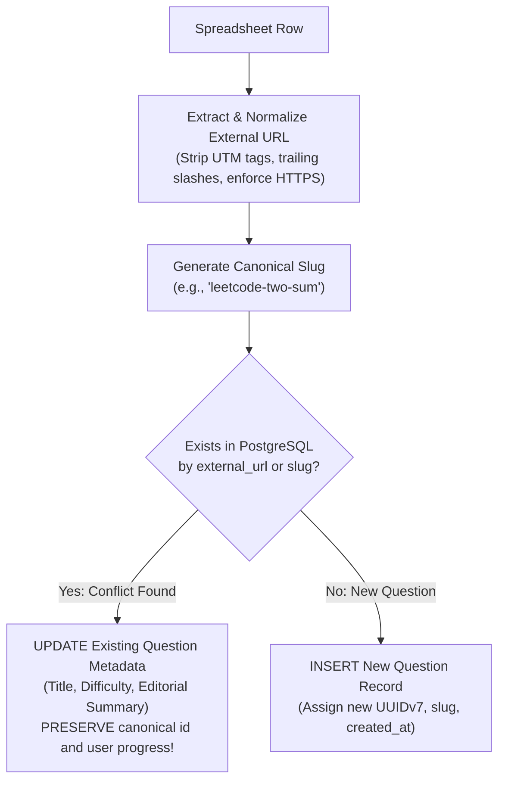

# Question Bank Import Specification — Adaptive DSA Interview Preparation Platform

## 1. Status & Unresolved Inputs

The curated master DSA question bank (approximately 600–700 questions) currently resides in an external Excel spreadsheet (`.xlsx` or `.csv`).

> [!IMPORTANT]
> **Workspace Status**: As of Phase 0, the spreadsheet file is **not yet present in the workspace repository**.
> In accordance with project instructions, the platform will **not** fabricate, scrape, or mock a replacement question bank. The exact spreadsheet structure remains an **unresolved input** until the user places the file into the workspace for inspection.

This document establishes the architecture, validation rules, duplicate detection mechanisms, and execution strategy for importing this dataset during **Phase 3**.

---

## 2. Importer Delivery Vehicle: CLI Tool vs. Admin Panel

### Recommended Strategy: Phase 3 CLI Script $\rightarrow$ Phase 4 Admin UI
We recommend implementing the initial importer as a **dedicated Go CLI command** (`cmd/import-questions/main.go`) during Phase 3, followed by an Admin Panel web interface in Phase 4.

| Dimension | CLI Tool (`cmd/import-questions`) | Admin Panel Web Upload UI |
| :--- | :--- | :--- |
| **Safety & Control** | **Superior**: Can be run with `--dry-run`, logs streaming progress to terminal, allows interactive confirmation before committing. | Subject to HTTP timeouts (e.g., 30s Caddy proxy timeout on 700 rows) and file upload size limits. |
| **Development Speed** | **Fast**: Implemented in pure Go with zero frontend overhead, unblocking Phase 3 core feature development immediately. | Requires multipart file upload forms, upload progress bars, and complex web error tables. |
| **Reusability** | The core parser and validator are encapsulated in `internal/catalog/importer`, allowing the Admin Panel in Phase 4 to import the exact same package without duplicating logic. | Same core logic, but delayed until frontend is built. |

---

## 3. Spreadsheet Inspection Checklist

When the user copies the Excel file into the workspace, the following structural characteristics must be verified before running the importer:

1. **File Format & Sheets**:
   - Single sheet vs. multiple sheets (e.g., one sheet per pattern or a unified master sheet).
   - Exact sheet name(s).
2. **Header Row Identification**:
   - Row number of the header (usually Row 1, but sometimes preceded by title or instructions in Rows 1–2).
3. **Column Name Mapping**:
   - Expected candidate columns:
     - *Problem Title* (e.g., "Two Sum", "3Sum", "Trapping Rain Water")
     - *Problem Link / URL* (e.g., `https://leetcode.com/problems/two-sum/`)
     - *Difficulty* (e.g., "Easy", "Medium", "Hard" or numeric 1–3)
     - *Primary Pattern* (e.g., "Two Pointers", "Sliding Window", "Dynamic Programming")
     - *Subpattern / Variation* (e.g., "Opposite Direction", "Fast & Slow", "Prefix Sum")
     - *Core vs. Reinforcement* (e.g., "Core", "Optional", "Must Do", "Bonus")
     - *Target Companies / Tags* (e.g., "Google, Meta", "Amazon", etc.)
     - *Prerequisites* (e.g., "Two Sum", "Binary Search")
     - *Editorial Notes / Hints* (Short explanation of the core trick)
4. **Cell Delimiter & Format Conventions**:
   - How multiple companies or multiple tags are separated (e.g., comma `,`, semicolon `;`, or newline `\n`).
   - Consistency of external URLs (clean URLs vs URLs with tracking query parameters).

---

## 4. Canonical Identity & Duplicate Detection

A fundamental invariant of this platform is that **each question has exactly one canonical identity across the entire system**.



### Conflict Resolution & Invariants
1. **Never Orphan User Progress**:
   - Re-importing the spreadsheet or running updates **must never** delete rows from `questions`. Doing so would trigger cascade deletes or foreign key errors in `user_question_progress`, destroying candidate study history.
2. **Metadata `UPSERT`**:
   - If a question with matching `external_url` already exists, only editable metadata (`difficulty`, `editorial_summary`, `sample_time_limit_mins`) and pattern associations are refreshed.
3. **Fuzzy Title Warnings**:
   - If a row has an identical title to an existing question but a different external URL, the importer flags a `WARNING: Potential duplicate title with different URL` for manual review.

---

## 5. Proposed Mapping Strategy

```text
[Spreadsheet Column]                  [PostgreSQL Target]
--------------------                  -------------------
Title                         ----->  questions.title
External URL (Normalized)     ----->  questions.external_url & questions.slug
Difficulty (EASY/MED/HARD)    ----->  questions.difficulty
Core / Reinforcement Flag     ----->  questions.is_core
Editorial Notes               ----->  questions.editorial_summary
Pattern Name                  ----->  patterns.name (lookup or auto-create)
                                      question_patterns (link as is_primary = TRUE)
Subpattern / Variation Name   ----->  patterns.name (child pattern)
                                      question_patterns (link as is_primary = FALSE)
Company Mentions              ----->  companies.name
                                      question_company_evidence (confidence: 'CONFIRMED')
Prerequisite Titles           ----->  question_prerequisites (resolved by title/slug lookup)
```

---

## 6. Two-Phase Execution: Dry-Run Preview & Validation

To prevent corrupting the database with malformed rows, the CLI importer operates in two distinct phases:

### Phase A: Dry-Run Validation (`--dry-run`)
Reads the entire spreadsheet, performs all validations, checks against current database state, and prints a comprehensive audit report without executing a transaction:

```text
$ go run cmd/import-questions/main.go --file=master_dsa_bank.xlsx --dry-run

=== QUESTION BANK IMPORT VALIDATION REPORT ===
File: master_dsa_bank.xlsx
Total Rows Read: 684
Valid Rows: 681
Invalid / Skipped Rows: 3

Summary of Proposed Actions:
  - New Questions to Insert: 650
  - Existing Questions to Update: 31
  - New Patterns to Create: 18
  - Company Evidence Records to Create: 412
  - Prerequisite Links to Establish: 94

Errors / Warnings:
  [Row 42]: Invalid external URL: "htt://leetcode/bad" (Skipped)
  [Row 118]: Missing difficulty value (Defaulted to MEDIUM)
  [Row 304]: Unknown prerequisite "Super Two Sum" not found in catalog (Warning)

Status: DRY-RUN COMPLETED. No database changes were made.
Run with --commit to execute changes.
```

### Phase B: Atomic Commit (`--commit`)
When executed with the `--commit` flag:
1. Opens a PostgreSQL transaction (`BEGIN`).
2. Upserts patterns, questions, company links, and prerequisites in dependency order.
3. If any unexpected error occurs, issues a `ROLLBACK`, leaving the database untouched.
4. If successful, executes `COMMIT` and records an entry in `audit_logs`.

---

## 7. Next Steps for Phase 3
1. User provides the spreadsheet file in `data/` or project root.
2. Inspect column headers and sample data using a quick Go inspection script or terminal tool.
3. Implement `internal/catalog/importer/` with Excel parser library (`github.com/xuri/excelize/v2`).
4. Execute dry-run and review validation report with the user before committing.
